# Лабораторная работа №3. Облачные сети. Amazon VPC

**Выполнил**

- Балев Вадим

**Группа**

- I2402

**Специальность**

- Информатика

**Номер**

- 1

**Уровень**

- Продвинутый

**Ссылка на публичный репозиторий в организации GitHub**

- https://github.com/blackrosegarrote-cloud/timecapsule

## Цель работы

Научиться строить собственную сеть в AWS: разбивать адресное пространство на подсети, настраивать маршрутизацию, выход в интернет и фильтрацию трафика. Затем перенести в эту сеть приложение из лабораторной работы №2 так, чтобы база данных оказалась в приватной подсети, куда из интернета нет дороги.

## Ход работы
### Задание 1. План адресов

| Подсеть     | Зона доступности | Диапазон       | Первый и последний адрес, доступный экземплярам | Сколько адресов доступно экземплярам |
| ----------- | ---------------- | -------------- | ----------------------------------------------- | ------------------------------------ |
| `public-a`  | `eu-central-1a`  | `10.1.0.0/24`  | `10.1.0.4` – `10.1.0.254`                       | 251                                  |
| `public-b`  | `eu-central-1b`  | `10.1.1.0/24`  | `10.1.1.4` – `10.1.1.254`                       | 251                                  |
| `private-a` | `eu-central-1a`  | `10.1.10.0/24` | `10.1.10.4` – `10.1.10.254`                     | 251                                  |
| `private-b` | `eu-central-1b`  | `10.1.11.0/24` | `10.1.11.4` – `10.1.11.254`                     | 251                                  |

**Вопрос**
- **Почему доступных адресов не 256? Какие адреса подсети 10.X.0.0/24 занимает AWS и для чего?**
  - Каждая подсеть `/24` содержит 256 адресов, однако AWS резервирует первые четыре и последний, поэтому экземплярам доступен 251 адрес. Если не считать первый адрес (сама сеть) и последний, который считается широковещательным (хотя в VPC широковещания нет but anyway), AWS также занимает адрес для VPC-маршрутизатора(10.X.0.1), для DNS(10.X.0.2 чаще всего, но может быть и другой адрес) и один адрес на будущее(10.X.0.3).
- **Сколько ещё подсетей /24 поместится в вашу VPC?**
  - В VPC с адресным пространством 10.0.0.0/16 теоретически можно разместить 256 подсетей с маской /24. Учитывая, что одна подсеть уже создана, остаётся место для 255 дополнительных подсетей.

### Задание 2. VPC и подсети

Создана VPC timecapsule-dev-vpc с диапазоном 10.X.0.0/16, включены DNS resolution и DNS hostnames. Созданы четыре подсети (public-a, public-b, private-a, private-b) с соответствующими CIDR-диапазонами и зонами доступности. Всем ресурсам назначены обязательные теги.

**Вопрос**

- **Является ли подсеть `public-a` сейчас публичной? Почему?**
  - Нет, на данном этапе `public-a` ещё не является публичной подсетью, несмотря на её название. Для этого в таблице маршрутизации должен присутствовать маршрут `0.0.0.0/0`, направленный на Internet Gateway, подключённый к VPC. Пока такого маршрута нет, экземпляры могут обмениваться данными внутри VPC, но не имеют прямого выхода в интернет.

### Задание 3. Internet Gateway и таблицы маршрутов

  
Маршруты таблицы `public-rt` и привязка подсетей `public-a` и `public-b`.

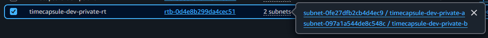  
Локальный маршрут таблицы `private-rt` и привязка подсетей `private-a` и `private-b`.

**Вопросы**

- **Какой маршрут есть в обеих таблицах, хотя вы его не добавляли? Что он даёт?**
  - В обеих таблицах автоматически присутствует маршрут `10.1.0.0/16` с целью `local`. Он создаётся AWS при создании VPC и позволяет экземплярам из разных подсетей одной VPC обмениваться данными через внутреннюю сеть. Благодаря этому веб-сервер из `public-a` может обращаться к базе данных в `private-a`, даже если эти подсети используют разные таблицы маршрутов.

- **Куда уйдёт пакет из `private-a`, адресованный `8.8.8.8`?**
  - Пакет не сможет покинуть VPC, поскольку в таблице `private-rt` существует только локальный маршрут `10.1.0.0/16`, а адрес `8.8.8.8` в этот диапазон не входит. Подходящего маршрута для такого пакета нет, поэтому он будет отброшен на уровне маршрутизации VPC. Наличие Internet Gateway у самой VPC ничего не меняет, пока приватная подсеть не имеет маршрута для внешнего трафика.

### Задание 4. Security Group

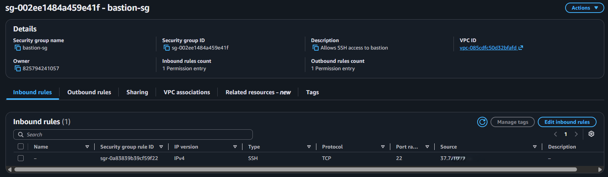  
Входящее правило `bastion-sg`, разрешающее SSH с моего IP-адреса.

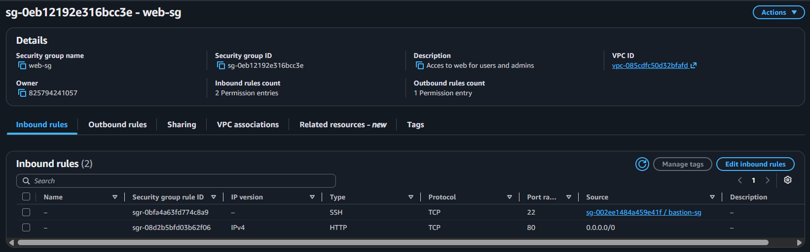  
Входящие правила `web-sg` для HTTP из интернета и SSH от `bastion-sg`.

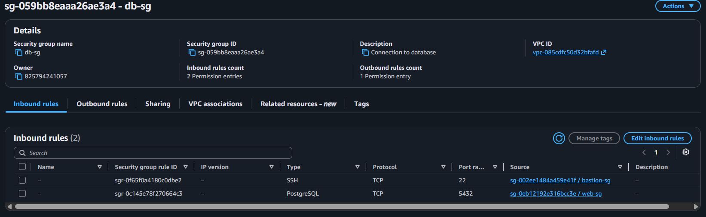  
Входящие правила `db-sg` для PostgreSQL от `web-sg` и SSH от `bastion-sg`.

**Настроенные правила**

| Security Group | Порт | Источник |
|---|---|---|
| `bastion-sg` | SSH (22) | `My IP` |
| `web-sg` | HTTP (80) | `0.0.0.0/0` |
| `web-sg` | SSH (22) | `bastion-sg` |
| `db-sg` | PostgreSQL (5432) | `web-sg` |
| `db-sg` | SSH (22) | `bastion-sg` |

Исходящие правила оставлены по умолчанию.

**Вопрос**

- **Почему в `db-sg` источником указана группа `web-sg`, а не адрес веб-сервера или диапазон `10.1.0.0/16`?**
  - Указание `web-sg` позволяет разрешить подключение к PostgreSQL только экземплярам, связанным с этой Security Group. Если приватный IP веб-сервера изменится или вместо него будет запущен другой экземпляр с той же группой, правило продолжит работать без изменений. Использование диапазона `10.1.0.0/16` предоставило бы доступ к порту базы всем экземплярам внутри VPC, включая те, которым он не требуется. Таким образом, ссылка на Security Group позволяет ограничить доступ по роли сервера, а не по его конкретному IP-адресу.

### Задание 5. Экземпляры

Для установки nginx через User data использован скрипт:

```bash
#!/bin/bash
dnf -y install nginx
echo "<h1>$(hostname)</h1><p>$(hostname -I)</p>" > /usr/share/nginx/html/index.html
systemctl enable --now nginx
```

Для всех экземпляров выбран Amazon Linux 2023 и тип `t3.micro`.

  
Страница `web-server` в браузере с именем сервера и его приватным IP-адресом.

**Подключение через bastion**

Для подключения к серверам через SSH был настроен файл `~/.ssh/config`.

```sshconfig
Host bastion
    HostName <публичный IP bastion>
    User ec2-user
    IdentityFile ~/.ssh/yournickname-keypair.pem

Host web
    HostName <приватный IP web-server>
    User ec2-user
    IdentityFile ~/.ssh/yournickname-keypair.pem
    ProxyJump bastion

Host db
    HostName <приватный IP db-server>
    User ec2-user
    IdentityFile ~/.ssh/yournickname-keypair.pem
    ProxyJump bastion
```

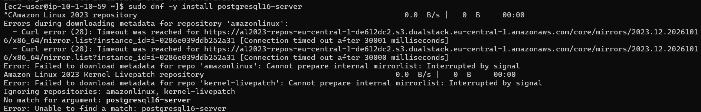  
Зависшая установка PostgreSQL на `db-server` из-за отсутствия выхода в интернет.

**Вопросы**

- **Почему `db-server` не может скачать пакеты, хотя `web-server` это делает?**
  - Веб-сервер находится в публичной подсети, имеет публичный IP-адрес и использует маршрут `0.0.0.0/0` через Internet Gateway. Сервер базы данных находится в приватной подсети без публичного адреса, а его таблица маршрутов содержит только локальный маршрут VPC. Поэтому `db-server` может взаимодействовать с другими экземплярами внутри сети, но не может обращаться к внешним репозиториям для скачивания пакетов.

- **Что нужно добавить в сеть, чтобы это стало возможно, и при этом `db-server` остался недоступным из интернета?**
  - Нужно создать публичный NAT Gateway с Elastic IP в публичной подсети и добавить в таблицу `private-rt` маршрут `0.0.0.0/0` через него. NAT Gateway будет принимать исходящие соединения от приватных экземпляров и отправлять их в интернет от своего публичного адреса. Ответы на эти соединения смогут возвращаться обратно, но инициировать новое соединение из интернета непосредственно с `db-server` по-прежнему будет нельзя.

### Задание 6. Временный NAT Gateway

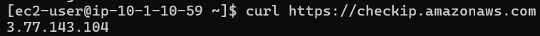  
Вывод `curl https://checkip.amazonaws.com` на `db-server` с публичным Elastic IP NAT Gateway.

```bash
curl https://checkip.amazonaws.com
sudo dnf -y update
sudo dnf -y install postgresql16-server
```

**Вопрос**

- **Какой адрес вернула первая команда? Сравните его с Elastic IP NAT Gateway. Почему это не адрес `db-server`?**
  - Команда `curl https://checkip.amazonaws.com` возвращает публичный Elastic IP, назначенный NAT Gateway. Это происходит потому, что NAT Gateway заменяет приватный адрес отправителя своим публичным адресом при передаче пакетов в интернет. Внешний сервер видит соединение от NAT Gateway, а не от `db-server`, у которого вообще нет публичного IP. При получении ответа NAT Gateway использует информацию о соединении, чтобы передать данные обратно нужному приватному экземпляру.

**Настройка PostgreSQL**

```bash
sudo postgresql-setup --initdb
```

```bash
sudo sed -i "s/^#listen_addresses = 'localhost'/listen_addresses = '*'/" /var/lib/pgsql/data/postgresql.conf
```

```bash
echo "host  all  all  10.1.0.0/24  scram-sha-256" | sudo tee -a /var/lib/pgsql/data/pg_hba.conf
```

```bash
sudo systemctl enable --now postgresql
```

```bash
sudo -u postgres psql -c "CREATE USER student WITH PASSWORD 'ваш-пароль';"
sudo -u postgres psql -c "CREATE DATABASE lab3 OWNER student;"
```

**Вопросы**

- **Доступ к базе теперь ограничивают три механизма: отсутствие публичного адреса и маршрута в Internet Gateway, Security Group `db-sg` и файл `pg_hba.conf`. Что делает каждый из них?**
  - Отсутствие публичного IP и прямого маршрута через Internet Gateway не позволяет обращаться к серверу базы напрямую из интернета. Security Group `db-sg` фильтрует входящие соединения и разрешает доступ к порту 5432 только экземплярам с группой `web-sg`, а SSH-доступ предоставляет группе `bastion-sg`. Файл `pg_hba.conf` дополнительно проверяет, с какого адреса и каким способом клиент может аутентифицироваться в PostgreSQL. В данном случае для сетевых подключений из `10.1.0.0/24` используется парольная аутентификация `scram-sha-256`.

- **Что произойдёт, если ошибиться только в одном из этих механизмов?**
  - Если ошибочно предоставить серверу публичный доступ, два остальных механизма всё ещё могут ограничивать подключения к базе, но изоляция на сетевом уровне будет нарушена. Если слишком широко открыть Security Group, к порту смогут обращаться дополнительные серверы, хотя PostgreSQL может отклонить их на этапе проверки `pg_hba.conf`. Если ошибиться в `pg_hba.conf`, можно либо заблокировать нужные подключения, либо разрешить аутентификацию нежелательным клиентам, которые уже имеют сетевой доступ к порту. Поэтому эти механизмы дополняют друг друга, и ошибка в одном из них не обязательно означает немедленный взлом, но ослабляет защиту системы.

**Удаление NAT Gateway**

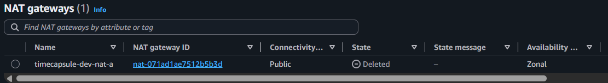  
Список NAT gateways, в котором `timecapsule-dev-nat-a` находится в состоянии `Deleted`.

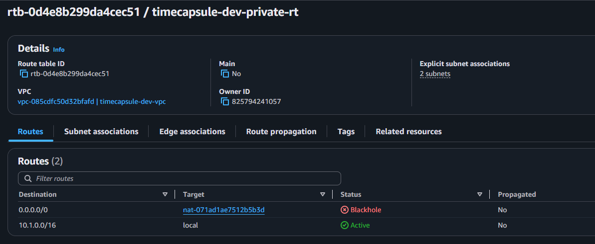  
Маршрут `0.0.0.0/0` в таблице `private-rt` в состоянии `Blackhole` после удаления NAT Gateway.

**Вопросы**

- **Почему PostgreSQL продолжает работать после удаления NAT Gateway?**
  - NAT Gateway использовался только для доступа к интернету во время установки пакетов и обновления системы. PostgreSQL уже установлен на локальный диск сервера, а его служба работает независимо от наличия интернета. Подключения от веб-сервера также продолжают работать, поскольку оба экземпляра находятся в одной VPC и обмениваются данными через локальный маршрут `10.1.0.0/16`.

- **Что придётся сделать, когда на `db-server` понадобится установить обновления безопасности?**
  - Потребуется временно восстановить исходящий доступ к интернету, например повторно создать NAT Gateway и добавить соответствующий маршрут в `private-rt`. После установки обновлений шлюз и маршрут можно снова удалить, чтобы не оплачивать неиспользуемые ресурсы. Другим вариантом может быть настройка доступа к необходимым репозиториям через внутренние зеркала или другие сетевые решения, но для данной лабораторной проще использовать временный NAT Gateway.

### Задание 7. Проверки

**Проверка доступа к базе**

```bash
sudo dnf -y install postgresql16
```

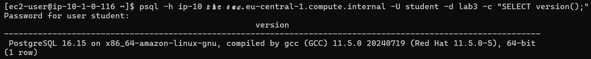  
Результат запроса `SELECT version()` через `psql` с `web-server`.

```bash
psql -h <приватный IP db-server> -U student -d lab3 -c "SELECT version();"
```

**Проверка Security Group**

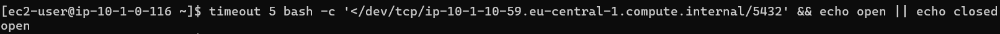  
Проверка порта 5432 с `web-server`, результат `open`.

```bash
timeout 5 bash -c '</dev/tcp/<приватный IP db-server>/5432' && echo open || echo closed
```

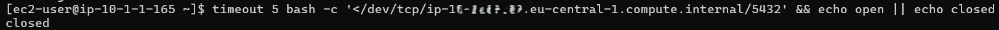  
Проверка порта 5432 с `bastion`, результат `closed`.

**Вопрос**

- **Почему с `web-server` порт открыт, а с `bastion` нет, хотя оба сервера в одной VPC и маршрут между ними есть?**
  - Маршрут `local` позволяет передавать пакеты между подсетями VPC, но сам по себе не разрешает устанавливать любые соединения. Security Group `db-sg` допускает подключения к порту 5432 только от экземпляров, связанных с `web-sg`, поэтому веб-сервер успешно подключается к PostgreSQL. Bastion использует другую Security Group и имеет разрешение только на SSH-доступ к серверу базы по порту 22. Его попытка подключения к порту 5432 блокируется на уровне Security Group, несмотря на наличие сетевого маршрута.

**Проверка изоляции базы данных**

**Вопросы**

- **Почему запрос не проходит?**
  - После удаления NAT Gateway из приватной таблицы маршрутов был также удалён маршрут `0.0.0.0/0`, поэтому у сервера базы больше нет пути в интернет. Адрес GitHub не принадлежит диапазону `10.1.0.0/16`, а других маршрутов в таблице нет. Даже несмотря на то, что исходящие соединения разрешены Security Group, отсутствие подходящего маршрута делает запрос невозможным.

- **Можно ли из интернета подключиться к порту 5432 `db-server`? Объясните по цепочке: маршрут, адрес, фильтры.**
  - Нет, поскольку `db-server` не имеет публичного IP-адреса, а его подсеть не содержит прямого маршрута через Internet Gateway. Даже если предположить, что пакет смог бы попасть во внутреннюю сеть, Security Group `db-sg` разрешает подключения к порту 5432 только от `web-sg`, а не от произвольных внешних адресов. Дополнительно PostgreSQL проверяет источник подключения через `pg_hba.conf`, где разрешена парольная аутентификация только из подсети `10.1.0.0/24`. Таким образом, доступ ограничен последовательно на уровне сетевой адресации, маршрутизации и фильтрации трафика, а затем средствами самой базы данных.

**Проверка Network ACL**

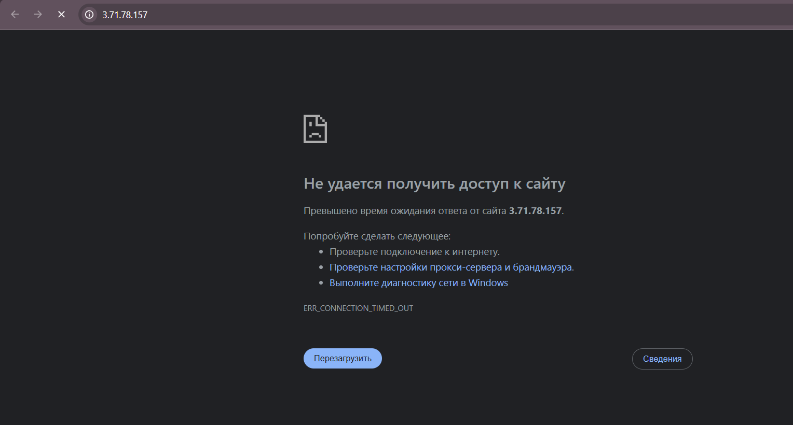  
После правила `Deny` в Network ACL SSH и сайт с моего IP-адреса недоступны.

Сайт открывается с телефона через мобильный интернет, поскольку используется другой IP-адрес.

**Вопросы**

- **Почему заблокировано и SSH, и сайт, хотя вы не меняли ни одной Security Group?**
  - Network ACL применяется ко всему трафику, проходящему через границу подсети, и проверяется независимо от Security Group конкретного экземпляра. Добавленное правило `Deny` блокирует входящий трафик с указанного IP-адреса до того, как он достигнет Security Group сервера. Поскольку и SSH-запросы, и HTTP-запросы поступают с одного внешнего адреса, блокируются оба типа соединений.

- **Почему с телефона сайт открывается?**
  - При подключении через мобильный интернет телефон использует другой внешний IP-адрес, отличный от адреса домашней сети. Правило Network ACL запрещает трафик только с указанного IP в формате `/32`, поэтому запросы с мобильного адреса под него не попадают. Для них продолжают действовать обычные правила, в том числе разрешение HTTP-доступа в `web-sg` от `0.0.0.0/0`.

- **Почему правило должно иметь номер меньше 100?**
  - Network ACL проверяет правила по возрастанию их номеров и применяет первое совпавшее правило. В стандартной Network ACL уже существует разрешающее правило с номером 100 для всего входящего трафика. Если создать запрещающее правило с номером больше 100, подходящий пакет будет разрешён раньше, чем проверка дойдёт до запрета. Поэтому правило с номером 90 срабатывает первым и блокирует указанный источник.

**Проверка имён и тегов**

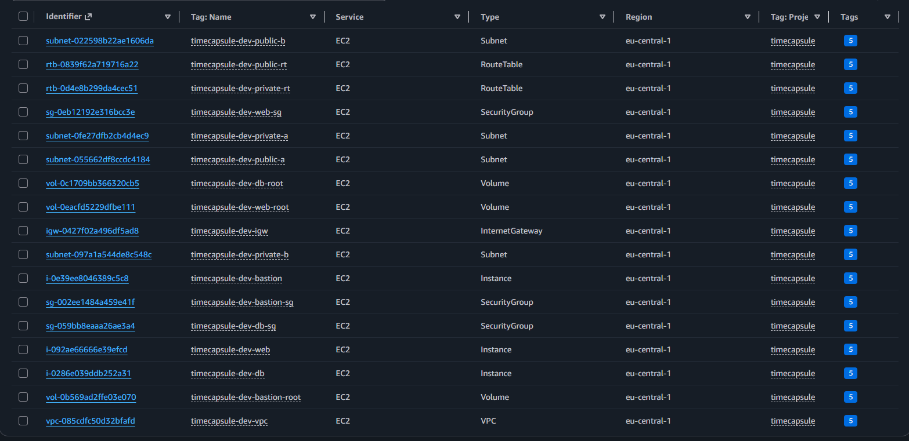  
Список ресурсов в Tag Editor с фильтром `Project = timecapsule`.

**Вопросы**

- **Как по тегам найти все ресурсы, которые нужно удалить после окончания проекта?**
  - В Tag Editor можно выбрать нужный регион и найти ресурсы по тегу `Project = timecapsule`, при необходимости дополнительно указав `Environment = dev` или номер лабораторной в теге `Lab`. Так можно получить список ресурсов, относящихся к проекту, даже если они находятся в разных сервисах AWS. Это упрощает удаление инфраструктуры после завершения работы и снижает риск оставить платные ресурсы. При этом нужно учитывать, что ресурсы без необходимых тегов не попадут в результаты такого поиска.

- **Зачем нужен тег `Owner`, если аккаунт у вас личный?**
  - Тег `Owner` обозначает ответственного за конкретный ресурс, а не владельца всего AWS-аккаунта. Даже в личном аккаунте могут находиться ресурсы разных проектов, а при переносе инфраструктуры в общий аккаунт этот тег позволит определить, к кому обращаться по вопросам обслуживания или удаления. Кроме того, теги можно использовать для автоматизации управления ресурсами и распределения затрат.

### Задание 8. Перенос сервера из ЛР2

Запуск `bastion`, `db-server` и сервера приложения из ЛР2. Проверка доступности исходного приложения.

Создание AMI `timecapsule-dev-app-lab2` на основе экземпляра `webserver`.

Запуск `timecapsule-dev-app` из созданного образа в подсети `public-a` с группой `web-sg`. В SSH-конфигурацию добавлен хост `app` с подключением через bastion.

После проверки нового экземпляра прежний `web-server` из первой части ЛР3 завершён.

**Вопросы**

- **Что содержит образ?**
  - AMI содержит снимки дисков экземпляра EC2, включая операционную систему, установленные программы, файлы приложения и конфигурации. Также образ содержит параметры, необходимые для запуска нового экземпляра. Это позволяет развернуть сервер с уже подготовленным окружением без повторной установки программного обеспечения.

- **Какие данные из ЛР2 оказались на `app-server` без всякой установки?**
  - На `app-server` были перенесены Amazon Linux 2023, nginx, PHP-FPM, PostgreSQL, файлы приложения TimeCapsule в `/var/www/timecapsule`, его зависимости и конфигурационные файлы, включая `.env`. Также сохранились настройки веб-сервера и системных служб. При этом сетевые параметры нового экземпляра задаются отдельно при его создании.

- **Где сейчас хранится база данных приложения?**
  - Основная база данных приложения находится на отдельном экземпляре `db-server` в приватной подсети `private-a`. PostgreSQL хранит её данные на EBS-томе этого экземпляра, а `app-server` подключается к нему по приватному IP-адресу. При этом AMI из ЛР2 также мог сохранить старую локальную базу данных, если она находилась на включённом в образ диске `webserver`.

### Задание 9. Elastic IP

Выделение Elastic IP `timecapsule-dev-app-eip` и привязка к экземпляру `app-server`. В файле `.env` изменён `APP_URL`, после чего перезагружена конфигурация PHP-FPM.

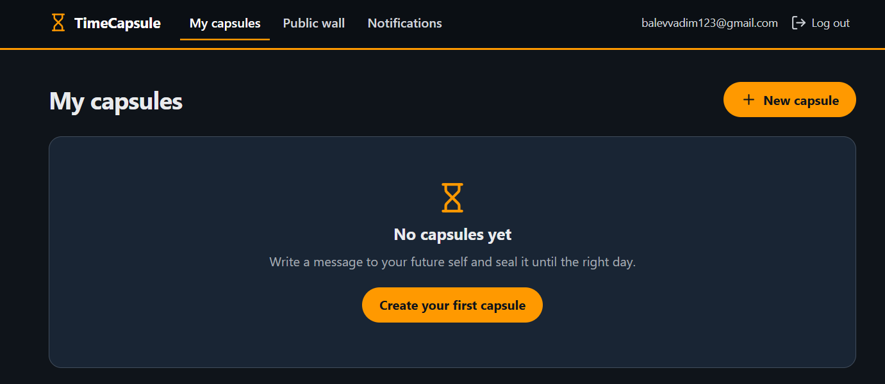  
Приложение открывается в браузере по постоянному Elastic IP.

**Вопросы**

- **Почему Elastic IP нужен `app-server`, но не нужен bastion?**
  - `app-server` размещает веб-приложение, к которому пользователи должны обращаться по постоянному публичному адресу. Elastic IP позволяет сохранить этот адрес даже после остановки и повторного запуска экземпляра. Bastion используется только для административного SSH-доступа, поэтому постоянный публичный IP ему не обязателен. При изменении адреса bastion достаточно обновить `HostName` в `~/.ssh/config`.

- **Сколько стоит Elastic IP, пока сервер остановлен, и почему?**
  - В регионе `eu-central-1` стандартная стоимость публичного IPv4-адреса составляет $0.005 в час, или около $3.60 за 30 дней. Плата взимается и при остановленном EC2, поскольку публичный IPv4-адрес остаётся выделенным для аккаунта и недоступным другим пользователям.

- **Когда в следующих работах перед сервером появится балансировщик нагрузки, понадобится ли Elastic IP?**
  - Elastic IP для `app-server` больше не потребуется, поскольку пользователи будут обращаться к приложению через публичный адрес балансировщика нагрузки. Сам сервер сможет находиться в приватной подсети без публичного IP.

### Задание 10. База данных приложения на `db-server`

На сервере базы данных созданы пользователь `timecapsule` и одноимённая база.

```bash
sudo -u postgres psql -c "CREATE USER timecapsule WITH PASSWORD 'новый-пароль';"
sudo -u postgres psql -c "CREATE DATABASE timecapsule OWNER timecapsule;"
```

В `pg_hba.conf` доступ ограничен пользователем `timecapsule`, базой `timecapsule` и подсетью `public-a`.

```text
host  timecapsule  timecapsule  10.1.0.0/24  scram-sha-256
```

```bash
sudo systemctl restart postgresql
```

**Вопросы**

- **Зачем для базы в отдельной сети нужен новый сильный пароль, если порт 5432 и так закрыт Security Group?**
  - Security Group ограничивает сетевой доступ к PostgreSQL, разрешая подключения на порт 5432 только из определённых источников, однако она не проверяет личность пользователя базы данных. Если злоумышленник получит доступ к `app-server` или другому разрешённому источнику, он сможет попытаться подключиться к PostgreSQL. Сильный пароль обеспечивает дополнительный уровень защиты, препятствуя несанкционированной аутентификации.

### Задание 11. Приватная зона Route 53

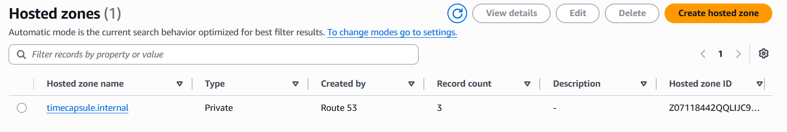  
Создание приватной зоны `timecapsule.internal`, связанной с VPC `timecapsule-dev-vpc`. Запись `db.timecapsule.internal` типа A указывает на приватный IP `db-server` с TTL 60 секунд.

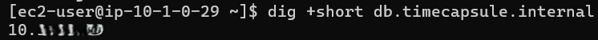  
Команда `dig +short db.timecapsule.internal` на `app-server` возвращает приватный адрес базы.

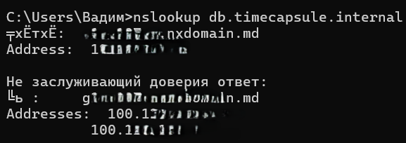  
Проверка `nslookup db.timecapsule.internal` на домашнем компьютере не находит приватное имя.

**Вопросы**

- **Почему с `app-server` имя находится, а с вашего компьютера нет?**
  - Домен `timecapsule.internal` создан в приватной зоне Route 53, связанной с VPC `timecapsule-dev-vpc`. DNS-записи этой зоны доступны через DNS-резолвер VPC, поэтому `app-server` может преобразовать `db.timecapsule.internal` в приватный IP-адрес базы данных. Компьютер за пределами VPC использует другие DNS-серверы, которым эта приватная зона недоступна, поэтому имя не разрешается.

- **Что придётся изменить, если `db-server` пересоздадут с другим адресом?**
  - Потребуется обновить значение A-записи `db.timecapsule.internal` в Route 53, указав новый приватный IP-адрес `db-server`. Изменять настройки подключения в `.env` на `app-server` не придётся, поскольку приложение использует DNS-имя вместо IP-адреса.

### Задание 12. Перенос данных и переключение приложения

Выгрузка локальной базы из ЛР2 в SQL-файл.

```bash
pg_dump -h localhost -U timecapsule -d timecapsule -f timecapsule.sql
```

Загрузка данных на отдельный сервер PostgreSQL по приватному DNS-имени.

```bash
psql -h db.timecapsule.internal -U timecapsule -d timecapsule -f timecapsule.sql
```

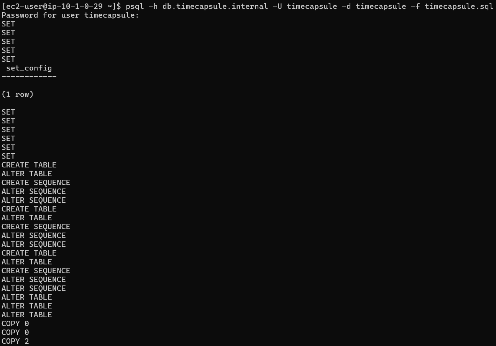  
Вывод `psql -f` после импорта таблиц и записей в новую базу данных.

В `.env` установлены `DB_HOST=db.timecapsule.internal` и новый `DB_PASSWORD`. После обновления настроек PHP-FPM локальная служба PostgreSQL отключена.

```bash
sudo systemctl reload php-fpm
sudo systemctl disable --now postgresql
```

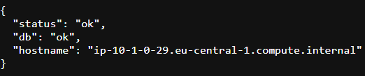  
Эндпоинт `/health` сообщает об успешном подключении к базе данных.

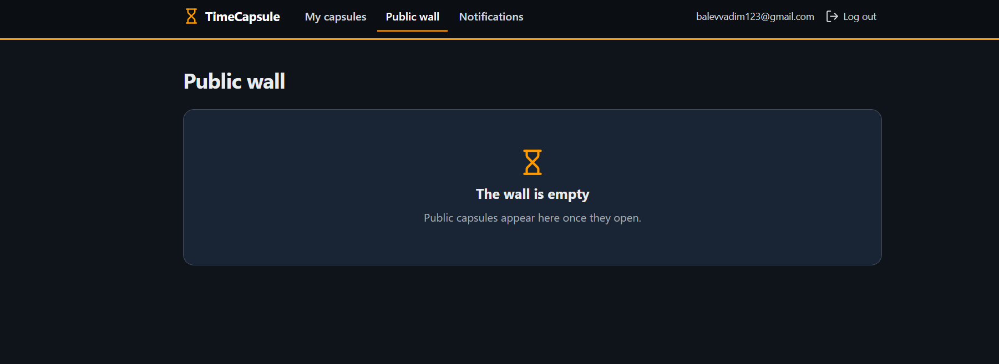

На странице приложения отображались бы сохранённые капсулы, созданные в ЛР2. Ничего нет, так как капсулы были удалены во время выполнения ЛР3 ранее (удаление старого пользователя и создание нового, поскольку пароль старого стёрся из памяти студента). В любом случае, процедура должна была показать корректный перенос БД. Все прошло успешно, этому свидетельствует `/health` и результат выполнения команды `psql -h db.timecapsule.internal -U timecapsule -d timecapsule -f timecapsule.sql`.

После проверки приложения образ `timecapsule-dev-app-lab2` снят с регистрации, а связанный снимок диска удалён.

**Вопросы**

- **Где лежат файлы, которые пользователи прикрепили к капсулам? Что с ними будет, если `app-server` удалить?**
  - Прикреплённые файлы хранятся в файловой системе `app-server` на его EBS-томе, а не в базе данных PostgreSQL. Они были перенесены вместе с AMI, поскольку образ содержит снимок диска исходного сервера. Если `app-server` удалить, его корневой EBS-том по умолчанию также будет удалён, что приведёт к потере загруженных файлов. При этом записи о файлах в базе данных могут сохраниться, но сами вложения станут недоступны. Для предотвращения потери данных необходимо организовать отдельное хранилище, например Amazon S3.

### Задание 13. Деплой и обслуживание

В подвал страницы добавлена строка, изменения отправлены в GitHub и развёрнуты на `app-server` через `deploy.sh`.

```bash
ssh app ./deploy.sh
```

  
Что было до деплоя.

  
После деплоя в подвале страницы отображается новая строка.

**Проверка отказа базы**

Сервер `db-server` остановлен для проверки поведения приложения при недоступной базе.

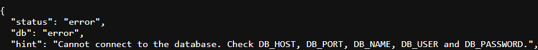  
Эндпоинт `/health` показывает ошибку проверки базы при остановленном `db-server`.

После повторного запуска `db-server` соединение восстановлено без изменения конфигурации приложения.

**Обновление пакетов на `db-server`**

Для временного доступа к интернету используются скрипты `scripts/nat-up.sh` и `scripts/nat-down.sh`. Первый выделяет Elastic IP, создаёт NAT Gateway и маршрут, второй удаляет маршрут и шлюз, дожидается удаления и освобождает адрес.

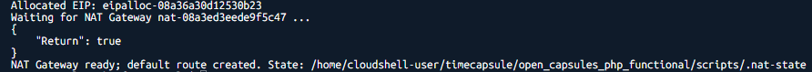  
Вывод `nat-up.sh` после создания временного NAT Gateway и маршрута.

```bash
sudo dnf -y update
```

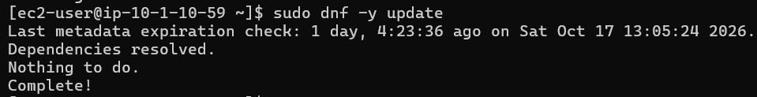  
Вывод обновления пакетов на `db-server` через временный NAT Gateway.

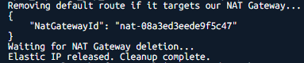  
Вывод `nat-down.sh` после удаления маршрута, NAT Gateway и освобождения Elastic IP.

Идентификаторы ресурсов сохраняются во временном файле, исключённом из Git через `.gitignore`. Скрипты используют `set -euo pipefail`, регион `eu-central-1` и обязательные теги ресурсов.

**Вопросы**

- **Почему в самом `deploy.sh` (или в командах варианта A) ничего менять не пришлось?**
  - Скрипт развёртывания выполняет те же действия, что и в ЛР2: получает обновления из GitHub и обновляет приложение на сервере. Изменился только способ SSH-подключения, поскольку теперь доступ к `app-server` осуществляется через bastion. Настройки `~/.ssh/config` позволяют использовать команду `ssh app` без указания промежуточного сервера и приватного IP-адреса. Поэтому сам процесс развёртывания остался прежним.

- **Что показал `/health` и почему? Изменился ли приватный адрес `db-server` после остановки и запуска?**
  - Во время остановки `db-server` проверка `/health` должна была показать ошибку или недоступность базы данных, поскольку приложение не могло установить соединение с PostgreSQL. Главная страница также могла перестать загружаться или отвечать с задержкой из-за ожидания соединения. После запуска `db-server` работа приложения восстановилась без изменения его настроек. Приватный IP-адрес базы данных не изменился, поскольку AWS сохраняет основной приватный IPv4-адрес EC2 при остановке и повторном запуске экземпляра.

- **Почему `nat-down.sh` должен освобождать Elastic IP только после того, как NAT Gateway удалён?**
  - Пока NAT Gateway существует, выделенный Elastic IP привязан к нему и не может быть освобождён. Поэтому скрипт сначала удаляет маршрут через NAT Gateway, затем сам шлюз и ожидает завершения его удаления. Только после освобождения адреса шлюзом можно выполнить `aws ec2 release-address`. Такой порядок предотвращает ошибки AWS API и позволяет прекратить начисление платы за неиспользуемый публичный IPv4-адрес.

### Задание 14. Архитектура и решение

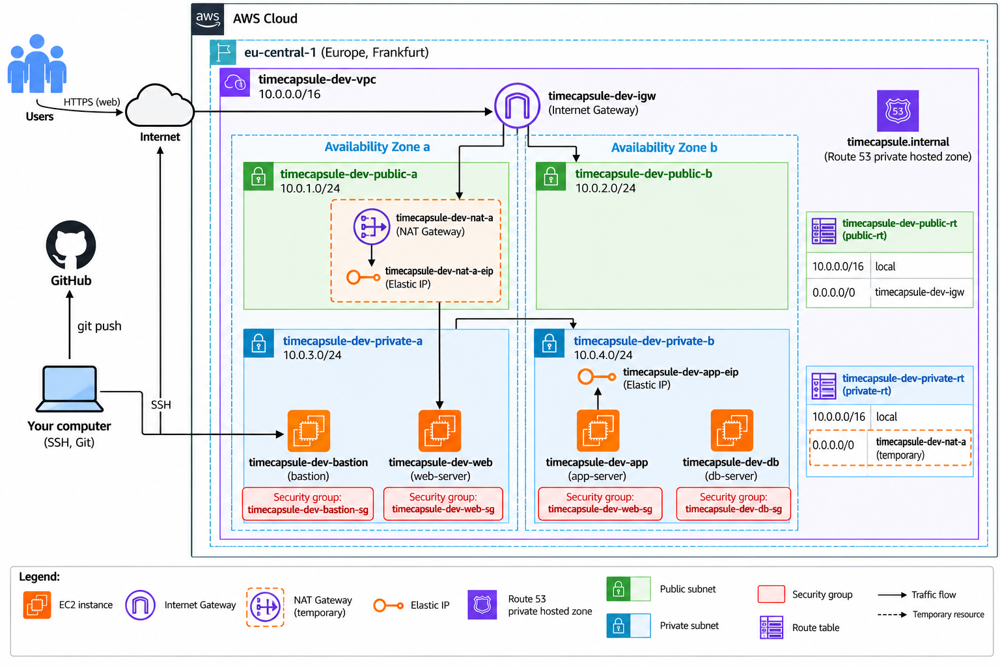  
Схема архитектуры

**Сcылка на adr0002-database-placement:**  
https://github.com/blackrosegarrote-cloud/timecapsule/blob/main/open_capsules_php_functional/docs/adr/0002-database-placement.md

### Контрольные вопросы

**1. Как проходит запрос пользователя от браузера до базы данных? Какие маршруты и какие правила фильтрации он проходит на каждом шаге?**

Пользователь отправляет HTTP-запрос на Elastic IP `app-server`, который через Internet Gateway поступает в публичную подсеть `public-a`, проходя проверки Network ACL и Security Group `web-sg`. Nginx передаёт запрос PHP-FPM, после чего приложение при необходимости обращается к базе по адресу `db.timecapsule.internal`. Трафик направляется по локальному маршруту VPC в приватную подсеть `private-a`, где проверяется Network ACL, Security Group `db-sg` и правила PostgreSQL в `pg_hba.conf`. После обработки запроса ответ возвращается приложению, а затем пользователю.

**2. Злоумышленник знает приватный IP `db-server`. Что ему нужно получить, чтобы подключиться к базе?**

Знания приватного IP недостаточно, поскольку `db-server` находится в приватной подсети и недоступен напрямую из интернета. Злоумышленнику потребуется получить сетевой доступ к разрешённому источнику внутри VPC, например скомпрометировать `app-server`, чтобы пройти ограничения Security Group и Network ACL. Дополнительно необходимо получить действительные учётные данные PostgreSQL и пройти проверку правил `pg_hba.conf`.

**3. Чем временный NAT Gateway лучше постоянного, и какие неудобства он создаёт?**

Временный NAT Gateway позволяет сократить расходы AWS, поскольку используется только во время обновления пакетов и других операций, требующих доступа в интернет. После завершения работы шлюз удаляется вместе с маршрутом и Elastic IP, что прекращает начисление платы за эти ресурсы. Недостатком является необходимость повторного создания шлюза, ожидания его готовности и изменения маршрутов при каждом обслуживании. Кроме того, между такими операциями приватные серверы не имеют исходящего доступа в интернет.

**4. Как изменится схема, если приложение должно пережить отказ зоны `eu-central-1a`? Каких ресурсов для этого не хватает?**

Для отказоустойчивости необходимо разместить экземпляры приложения в двух зонах доступности и добавить Application Load Balancer для распределения запросов между ними. Auto Scaling Group позволит автоматически восстанавливать экземпляры при сбоях, а Amazon RDS Multi-AZ обеспечит резервирование базы данных в другой зоне. Пользовательские файлы следует перенести в Amazon S3, чтобы они не зависели от локальных дисков EC2. Таким образом, инфраструктуре не хватает резервного сервера приложения, балансировщика нагрузки, отказоустойчивой базы данных и общего хранилища файлов.
