# Лабораторная работа №4. Облачные хранилища. Amazon S3

**Выполнил**

- Балев Вадим

**Группа**

- I2402

**Специальность**

- Информатика

**Уровень**

- Продвинутый

**Ссылка на публичный репозиторий в организации GitHub**

- https://github.com/blackrosegarrote-cloud/timecapsule

## Задание 1. Бакет и объекты в консоли

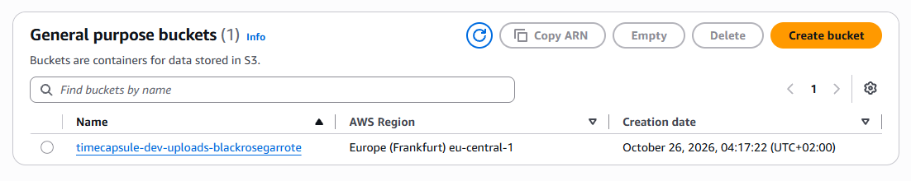

Создан бакет S3 `timecapsule-dev-uploads-<nickname>` с отключёнными ACL, блокировкой публичного доступа, шифрованием SSE-S3 и обязательными тегами. В бакете созданы папки `uploads` и `backups`, в которые загружены тестовые файлы.

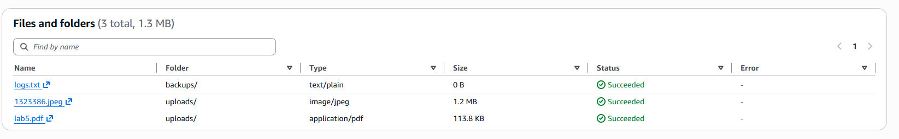

Просмотрены свойства загруженной картинки: ключ объекта, Content-Type, ETag и Object URL.

Проверена возможность открытия Object URL в браузере. Получена ошибка `AccessDenied`.

**Вопросы**

**Какой ключ у картинки?**

Ключ картинки - `uploads/<имя_файла>`. Он состоит из префикса `uploads/` и имени файла.

**Почему Object URL не открывается, хотя вы владелец бакета?**

Бакет блокирует публичный доступ, а обычный Object URL не содержит данных AWS-аутентификации. Поэтому S3 отклоняет запрос с ошибкой `AccessDenied`. Права владельца применяются при авторизованных запросах, но не передаются автоматически при открытии ссылки в браузере.

**Что на самом деле создала кнопка Create folder?**

В S3 отсутствуют настоящие папки, как в обычной файловой системе. Кнопка `Create folder` создаёт объект нулевого размера с ключом, заканчивающимся символом `/`. Папки отображаются виртуально на основе общих префиксов ключей объектов.

## Задание 2. Объекты из командной строки

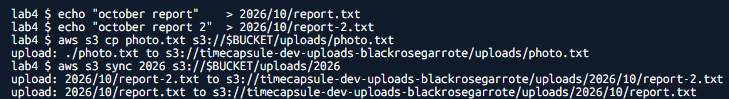

В CloudShell сохранено имя бакета в переменную `BUCKET`, созданы тестовые файлы и выполнена их загрузка с помощью команд `aws s3 cp` и `aws s3 sync`.

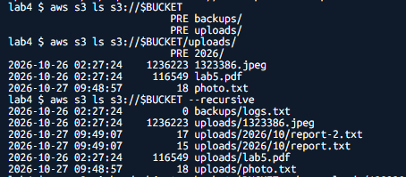

Содержимое бакета просмотрено тремя командами `aws s3 ls`: на уровне корня, внутри папки `uploads` и рекурсивно с отображением полных ключей объектов.

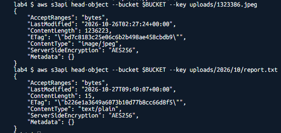

С помощью `aws s3api head-object` получены метаданные картинки и файла `uploads/2026/10/report.txt` без скачивания объектов.

Дополнительно проверено скачивание файла `photo.txt` с последующим выводом его содержимого и удаление объекта `report-2.txt` через AWS CLI.

**Вопросы**

**Почему первая команда ls показывает PRE uploads/ и PRE backups/, а третья показывает полные ключи?**

Обычная команда `aws s3 ls` группирует объекты по общим префиксам, отображая их как виртуальные папки с обозначением `PRE`.

Параметр `--recursive` отключает такую группировку и выводит все объекты бакета с полными ключами независимо от их вложенности.

**Какой Content-Type получил report.txt, хотя вы его не указывали?**

Файл получил Content-Type `text/plain`. AWS CLI автоматически определяет тип содержимого по расширению файла при загрузке. Расширению `.txt` соответствует обычный текстовый файл, поэтому указывать Content-Type вручную не потребовалось.

## Задание 3. Политика бакета: только HTTPS

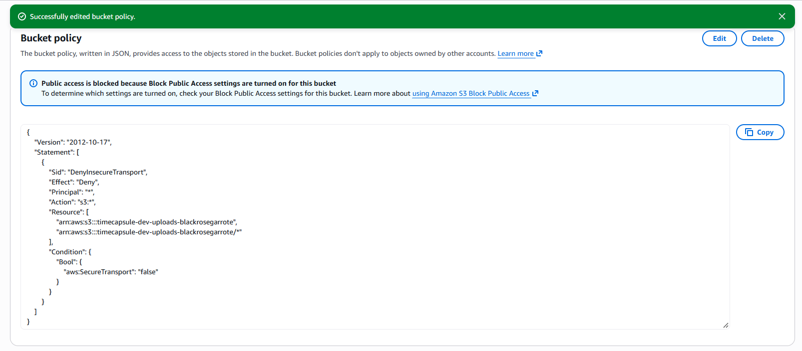

Для бакета создана политика, запрещающая любые операции с бакетом и его объектами при использовании незащищённого HTTP-соединения.

```json
{
  "Version": "2012-10-17",
  "Statement": [
    {
      "Sid": "DenyInsecureTransport",
      "Effect": "Deny",
      "Principal": "*",
      "Action": "s3:*",
      "Resource": [
        "arn:aws:s3:::timecapsule-dev-uploads-blackrosegarrote",
        "arn:aws:s3:::timecapsule-dev-uploads-blackrosegarrote/*"
      ],
      "Condition": {
        "Bool": {
          "aws:SecureTransport": "false"
        }
      }
    }
  ]
}
```

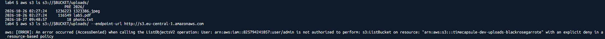

Работа политики проверена в CloudShell. Запрос через HTTPS выполнен успешно, а запрос через HTTP завершился ошибкой `AccessDenied`.

**Вопросы**

**Почему вторая команда получает AccessDenied, хотя у вас права администратора?**

Политика бакета содержит явный запрет `Deny` для запросов, использующих HTTP. В AWS явный запрет имеет приоритет над любыми разрешениями `Allow`, включая административные права. Поэтому запрос блокируется независимо от полномочий пользователя.

**Почему Block Public Access не помешал сохранить политику с Principal: "*"?**

`Principal: "*"` указывает на всех участников, но сама политика не предоставляет им доступ. Она содержит только запрет `Deny` для незащищённых соединений. Block Public Access препятствует предоставлению публичного доступа, а не созданию ограничивающих политик.

## Задание 4. Версионирование и защита от удаления

В настройках бакета включено версионирование. Установлено, что объекты, загруженные до его включения, имеют идентификатор версии `null`.

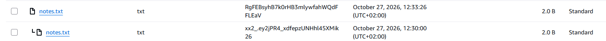

В папку `uploads` дважды загружен файл `notes.txt` с содержимым `v1` и `v2`, в результате чего создана история версий.

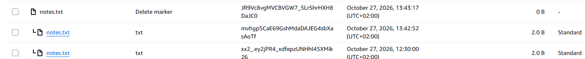

После обычного удаления `notes.txt` объект исчез из списка, но его версии сохранились. При включении `Show versions` обнаружен маркер удаления `Delete marker`.

Маркер удаления удалён, после чего файл восстановился с содержимым `v2`.


Версия `v2` удалена окончательно. После удаления текущей стала предыдущая версия `v1`.

**Вопросы**

**Чем удаление в шаге 3 отличается от удаления в шаге 5?**

В шаге 3 выполняется обычное удаление объекта. S3 создаёт `Delete marker`, который становится текущей версией и скрывает объект, но предыдущие версии сохраняются.

В шаге 5 удаляется конкретная версия по её идентификатору. Такое удаление является окончательным, и данные этой версии больше не хранятся в бакете.

**Какое из них можно отменить?**

Обычное удаление можно отменить, удалив `Delete marker`. После этого предыдущая версия объекта снова становится доступной.

Окончательное удаление конкретной версии нельзя отменить средствами версионирования S3, поскольку соответствующие данные удаляются безвозвратно.

**Какой из двух способов защищает от случайного удаления, а какой нужно запрещать приложению?**

Обычное удаление с созданием `Delete marker` защищает от случайной потери данных, поскольку позволяет восстановить предыдущую версию.

Приложению следует запрещать окончательное удаление версий, не предоставляя разрешение `s3:DeleteObjectVersion`. Это предотвращает безвозвратное удаление сохранённых данных.

## Задание 5. Правило жизненного цикла

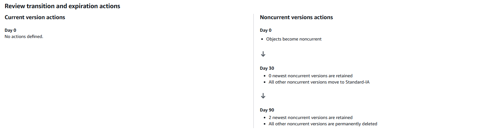

Создано правило жизненного цикла `timecapsule-dev-noncurrent`, действующее только для объектов с префиксом `uploads/`. Настроен переход неактуальных версий в Standard-IA через 30 дней, их удаление через 90 дней с сохранением двух последних неактуальных версий и очистка незавершённых multipart-загрузок через 7 дней.

**Вопросы**

**Как поведёт себя правило для файла, который перезаписывали 10 раз за неделю? Какие версии и когда окажутся в Standard-IA, какие будут удалены?**

После десяти перезаписей образуется 11 версий объекта: одна текущая и десять неактуальных.

Через 30 дней после потери актуальности версии, удовлетворяющие требованиям перехода, перемещаются в Standard-IA. Если ограничение на сохранение новых версий для перехода не установлено, все десять неактуальных версий могут перейти в этот класс хранения.

Через 90 дней после потери актуальности восемь самых старых неактуальных версий будут удалены, а две наиболее новые сохранятся. Сроки рассчитываются отдельно для каждой версии с момента, когда она стала неактуальной.

**Почему наши маленькие тестовые файлы в Standard-IA не попадут?**

По умолчанию S3 Lifecycle не переводит объекты размером менее 128 КБ в другие классы хранения. Наши тестовые файлы значительно меньше установленного ограничения.

Кроме того, для Standard-IA предусмотрен минимальный тарифицируемый размер объекта 128 КБ, поэтому хранение маленьких файлов в этом классе обычно невыгодно.

**Что такое незавершённая загрузка частями и почему за неё приходится платить?**

Multipart upload позволяет загружать большие файлы отдельными частями. Если загрузка прервётся или не будет завершена, уже загруженные части останутся в S3.

Они продолжают занимать место и тарифицироваться, даже если готовый объект не был создан. Правило жизненного цикла автоматически удаляет незавершённые загрузки через 7 дней, предотвращая накопление лишних расходов.

## Задание 6. Подписанные URL

Для картинки создана подписанная ссылка сроком на 5 минут. Проверена возможность открытия приватного объекта в режиме инкогнито без авторизации в AWS.

В CloudShell создана подписанная ссылка на `uploads/photo.txt` сроком на 120 секунд:

```bash
aws s3 presign s3://$BUCKET/uploads/photo.txt --expires-in 120
```

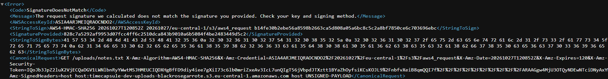

В подписанной ссылке имя `photo.txt` заменено на `notes.txt`. При открытии изменённого URL S3 вернул ошибку `SignatureDoesNotMatch`.

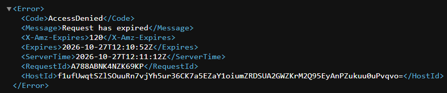

После истечения срока действия исходная ссылка открыта повторно. S3 отклонил запрос с ошибкой `AccessDenied` и сообщением об истечении срока действия ссылки.

**Вопросы**

**Какие ошибки вернул S3 в шагах 3 и 4?**

В шаге 3 S3 вернул `SignatureDoesNotMatch`, поскольку изменение ключа объекта нарушило соответствие между запросом и цифровой подписью.

В шаге 4 S3 вернул `AccessDenied` с сообщением `Request has expired`, поскольку срок действия подписанной ссылки закончился.

**Почему нельзя получить другой файл, просто поменяв ключ в ссылке?**

Подписанная ссылка содержит цифровую подпись, рассчитанную с учётом параметров запроса, включая путь к объекту. При изменении ключа подпись перестаёт соответствовать запросу, поэтому S3 отклоняет обращение, даже если другой объект существует.

**Обращалась ли команда aws s3 presign к S3, когда создавала ссылку?**

Нет. Команда `aws s3 presign` формирует подписанную ссылку локально с использованием AWS-учётных данных и алгоритма Signature Version 4. Сам запрос к S3 выполняется только при открытии созданной ссылки. При необходимости AWS CLI может отдельно обратиться к сервису получения временных учётных данных.

После завершения первой части временные файлы удалены из CloudShell командой:

```bash
cd ~ && rm -rf lab4
```

Бакет S3 сохранён для выполнения второй части лабораторной работы.

## Задание 7. Политика приложения

В IAM создана политика `timecapsule-dev-app-s3`, предоставляющая приложению минимально необходимые разрешения для работы с объектами в `uploads/`.

```json
{
  "Version": "2012-10-17",
  "Statement": [
    {
      "Sid": "ListUploads",
      "Effect": "Allow",
      "Action": "s3:ListBucket",
      "Resource": "arn:aws:s3:::timecapsule-dev-uploads-blackrosegarrote",
      "Condition": {
        "StringLike": {
          "s3:prefix": ["uploads/*"]
        }
      }
    },
    {
      "Sid": "ManageUploads",
      "Effect": "Allow",
      "Action": [
        "s3:GetObject",
        "s3:PutObject",
        "s3:DeleteObject"
      ],
      "Resource": "arn:aws:s3:::timecapsule-dev-uploads-blackrosegarrote/uploads/*"
    }
  ]
}
```

Политика разрешает просмотр содержимого `uploads/`, а также чтение, загрузку и удаление объектов внутри этого префикса. Доступ к остальным объектам бакета не предоставляется.

**Вопросы**

**Почему s3:ListBucket относится к ресурсу "бакет", а s3:GetObject к ресурсу "объект"?**

Действие `s3:ListBucket` выполняется над бакетом, поскольку запрашивает список содержащихся в нём объектов. Поэтому для него указывается ARN бакета без дополнительного пути.

Действие `s3:GetObject` выполняется над конкретным объектом, поэтому требует ARN объекта с соответствующим ключом или префиксом.

**Что произойдёт, если перепутать ARN в этих двух правилах?**

Разрешения не будут соответствовать типам ресурсов, для которых предназначены действия. В результате AWS не сможет применить соответствующие разрешения, и запросы будут отклоняться с `AccessDenied`, если доступ не предоставлен другой политикой.

## Задание 8. Проверка прав через тестовую роль

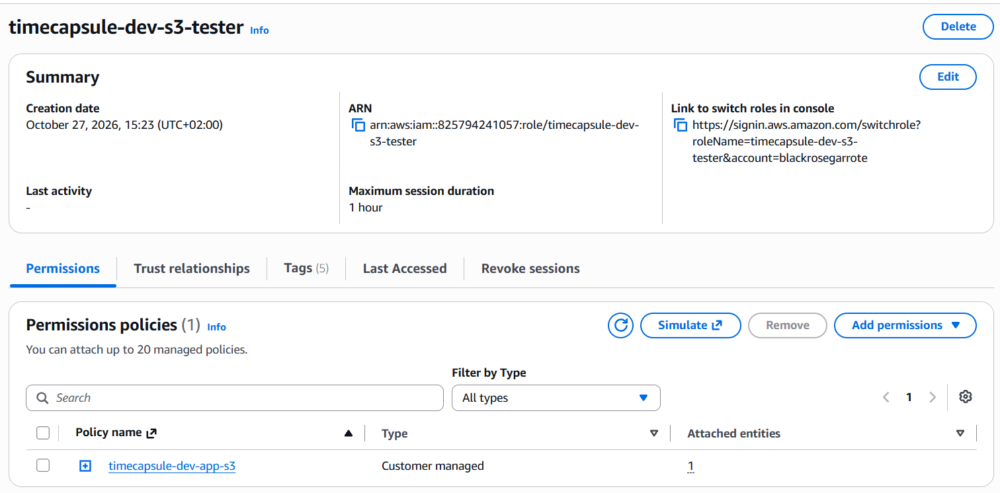

Создана роль `timecapsule-dev-s3-tester` с доверием к текущему AWS-аккаунту. К роли прикреплена только политика `timecapsule-dev-app-s3`.

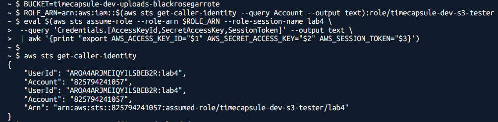

В CloudShell выполнен `aws sts assume-role`, после чего полученные временные учётные данные записаны в переменные окружения. Командой `aws sts get-caller-identity` проверено использование тестовой роли.

Проверены разрешённые и запрещённые операции с S3 от имени тестовой роли.

| № | Операция | Ожидаю | Получил | Какое правило сработало |
|---|---|---|---|---|
| 1 | Загрузка `uploads/test.txt` | разрешено | разрешено | Разрешение в политике приложения |
| 2 | Просмотр `uploads/` | разрешено | разрешено | Разрешение в политике приложения |
| 3 | Просмотр корня бакета | AccessDenied | AccessDenied | Неявный запрет |
| 4 | Чтение `uploads/photo.txt` | разрешено | разрешено | Разрешение в политике приложения |
| 5 | Просмотр `backups/` | AccessDenied | AccessDenied | Неявный запрет |
| 6 | Загрузка `backups/test.txt` | AccessDenied | AccessDenied | Неявный запрет |
| 7 | Просмотр версий объектов | AccessDenied | AccessDenied | Неявный запрет |
| 8 | Удаление конкретной версии | AccessDenied | AccessDenied | Неявный запрет |
| 9 | Обычное удаление `uploads/test.txt` | разрешено | разрешено | Разрешение в политике приложения |
| 10 | Просмотр `uploads/` через HTTP | AccessDenied | AccessDenied | Явный запрет в политике бакета |

После проверки временные учётные данные роли удалены из переменных окружения, восстановлены исходные права пользователя CloudShell.

**Вопросы**

**Чем политика доверия роли отличается от политики прав?**

Политика доверия определяет, кому разрешено принимать роль с помощью `sts:AssumeRole`. Политика прав определяет, какие действия разрешены после получения роли и к каким ресурсам предоставляется доступ.

Таким образом, первая управляет возможностью использования роли, а вторая - её полномочиями.

**Что на самом деле произошло с test.txt после команды 9, и можно ли его восстановить?**

Поскольку в бакете включено версионирование, обычное удаление создало `Delete marker`. Объект исчез из стандартного списка, но его предыдущие версии сохранились.

Файл можно восстановить, удалив маркер удаления через консоль S3 или API.

**Сможет ли злоумышленник, получивший учётные данные приложения, уничтожить файлы пользователей без возможности восстановления? А если бы в политике было "s3:*"?**

С текущей политикой злоумышленник может загружать, читать и выполнять обычное удаление объектов в `uploads/`, но не может окончательно удалять их версии, поскольку отсутствует разрешение `s3:DeleteObjectVersion`.

Если бы политика содержала `s3:*` для соответствующих ресурсов, злоумышленник получил бы значительно более широкие полномочия, включая возможность окончательного удаления версий, если это не запрещено другими политиками. Поэтому использование минимальных разрешений снижает риск безвозвратной потери данных.

## Задание 9. Роль сервера

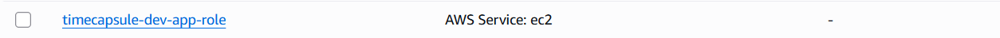

Создана IAM-роль `timecapsule-dev-app-role` с типом доверенной сущности `AWS service` и вариантом использования `EC2`. К роли прикреплена политика `timecapsule-dev-app-s3`.

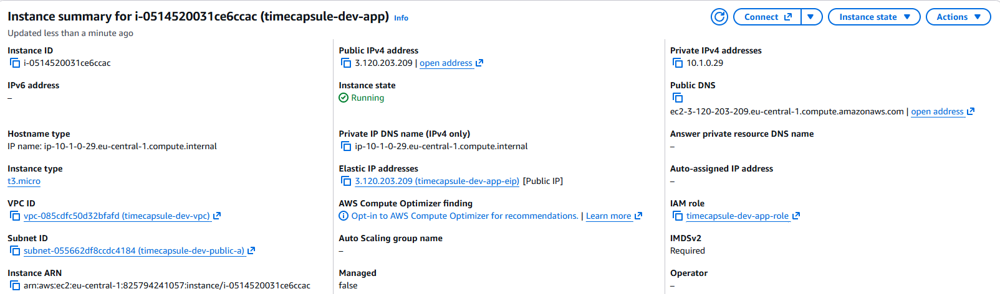

Роль привязана к экземпляру `timecapsule-dev-app` через настройки безопасности EC2 без перезапуска сервера.

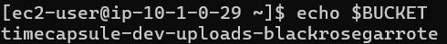

На `app-server` настроена переменная `BUCKET`. С помощью AWS CLI проверена текущая роль и доступ к объектам S3. Просмотр `uploads/` разрешён, а доступ к `backups/` отклонён.

**Вопросы**

**Где AWS CLI на сервере взял учётные данные, если вы не выполняли aws configure и не вызывали assume-role?**

EC2 автоматически предоставляет временные учётные данные назначенной IAM-роли через Instance Metadata Service (IMDS). AWS CLI получает их с помощью стандартной цепочки поиска учётных данных, поэтому ручная настройка ключей не требуется.

**Чем политика доверия этой роли отличается от тестовой?**

Тестовая роль доверяет участникам указанного AWS-аккаунта, которым разрешено выполнять `sts:AssumeRole`.

Роль сервера доверяет сервису EC2 через принципал `ec2.amazonaws.com`, что позволяет экземпляру использовать назначенные разрешения.

**Почему такие учётные данные безопаснее ключа доступа в файле .env?**

Временные учётные данные автоматически обновляются и имеют ограниченный срок действия. Их не требуется сохранять в конфигурационных файлах или репозитории.

Постоянный ключ в `.env` может быть случайно раскрыт и продолжать действовать до ручного отзыва. Использование IAM-роли уменьшает этот риск, хотя временные данные тоже необходимо защищать.

## Задание 10. Перенос существующих файлов

На `app-server` выполнена предварительная проверка синхронизации локальных вложений с S3 с помощью параметра `--dryrun`.

```bash
cd /var/www/timecapsule/current
aws s3 sync storage/uploads s3://$BUCKET/uploads/ --dryrun
```

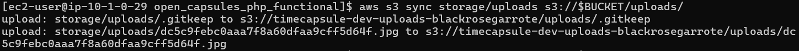

Выполнена синхронизация файлов из `storage/uploads` в бакет S3 с помощью `aws s3 sync`.

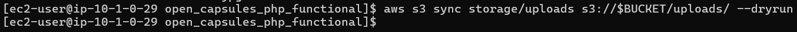

Повторная проверка с `--dryrun` не обнаружила файлов для копирования, что подтверждает завершение синхронизации. Также проверен Content-Type одного из перенесённых объектов.

**Вопросы**

**Хватило ли для aws s3 sync прав политики приложения? Какие из разрешённых действий использовала команда?**

Да, предоставленных разрешений достаточно для синхронизации файлов из локальной папки в S3.

Команда использует `s3:ListBucket` для проверки уже существующих объектов под префиксом `uploads/` и `s3:PutObject` для загрузки новых или изменённых файлов.

Разрешение `s3:GetObject` может потребоваться при обратной синхронизации из S3, но для обычной загрузки локальных файлов оно не является обязательным.

## Задание 11. Модуль хранения на S3

В приложение добавлена библиотека `aws/aws-sdk-php` для взаимодействия с Amazon S3.

```bash
composer require aws/aws-sdk-php
```

В `.env.example` и серверную конфигурацию `.env` добавлены настройки бакета и региона AWS.

```env
S3_BUCKET=timecapsule-dev-uploads-<nickname>
AWS_REGION=eu-central-1
```

Ключи доступа IAM не используются, поскольку SDK автоматически получает временные учётные данные роли EC2.

Модуль `src/storage.php` переработан для хранения вложений в S3. Функция `storage_save()` загружает объекты через `putObject`, а `storage_delete()` выполняет удаление через `deleteObject`.

Функция `storage_stream()` изменена для формирования подписанного URL сроком на 5 минут и перенаправления браузера с HTTP-кодом 302. При формировании ссылки сохраняются исходное имя файла, Content-Type и способ отображения вложения.


В подвале приложения информация о локальном хранилище заменена на имя используемого бакета S3.

## Задание 12. Деплой и проверка

Новая версия приложения развёрнута на `app-server`. Установлены необходимые зависимости Composer, применены настройки S3 и перезапущены компоненты приложения.

Созданы две новые капсулы с вложениями в виде картинки и PDF. Время открытия установлено на несколько минут позже создания.

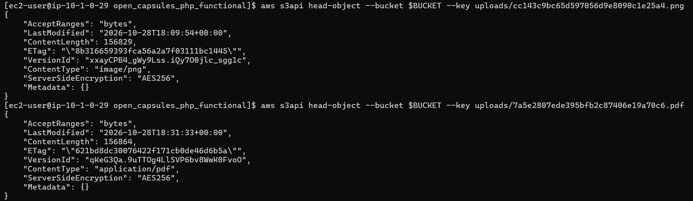

В бакете S3 обнаружены новые объекты под префиксом `uploads/`. Проверены их ключи и соответствующие Content-Type.

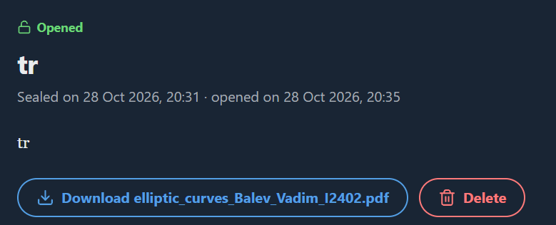

После открытия капсул проверена загрузка картинки через подписанный URL S3 с параметрами `X-Amz-*`. PDF успешно скачан с сохранением исходного имени файла.

Проверена старая капсула, созданная в предыдущих лабораторных работах. Её вложение также успешно получено из S3.

Подписанная ссылка на картинку скопирована и повторно открыта после истечения пяти минут. S3 отклонил запрос из-за окончания срока действия подписи.

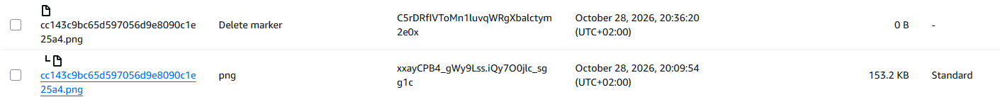

Удалена капсула с вложением. При включённом `Show versions` обнаружен маркер удаления объекта, подтверждающий сохранение предыдущей версии файла.

**Вопросы**

**Почему ссылку, которую пользователь переслал другу, не нужно специально отзывать?**

Подписанный URL имеет ограниченный срок действия, после истечения которого S3 автоматически перестаёт принимать запросы с этой подписью.

Поэтому ссылка становится недействительной без дополнительных действий со стороны приложения. До истечения срока любой обладатель ссылки может использовать её, поэтому срок действия намеренно ограничен пятью минутами.

**Что осталось в бакете после удаления капсулы и когда это исчезнет окончательно?**

После удаления капсулы приложение выполняет обычное удаление объекта в S3. Поскольку версионирование включено, создаётся `Delete marker`, а предыдущие версии остаются в бакете.

Правило жизненного цикла предусматривает удаление неактуальных версий после 90 дней с сохранением двух наиболее новых. Поэтому при наличии лишь одной неактуальной версии она продолжит храниться, пока не изменятся условия её удаления или настройки правила.

## Задание 13. Сервер без состояния

На `app-server` локальная папка с вложениями перемещена во временное расположение.

```bash
sudo mv /var/www/timecapsule/current/storage/uploads ~/uploads-backup
```

Проверена работа старых и новых капсул, а также создание капсулы с новым вложением. Приложение продолжило работать без локального хранилища файлов, после чего резервная папка удалена.

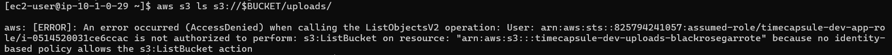

Для политики `timecapsule-dev-app-s3` создана новая версия без разрешения `s3:ListBucket`. Проверено, что приложение продолжает работать, а попытка просмотра списка объектов с сервера возвращает `AccessDenied`.

Выполнены запросы несуществующего объекта `uploads/no-such-file.txt` с сервера и из CloudShell под административным пользователем. Результаты сравнены:

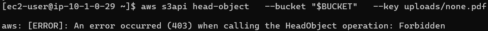

Запрещено выполнение действия.

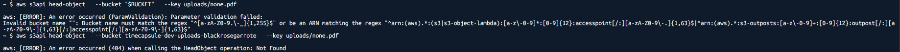

Файл не найден.

**Вопросы**

**Почему S3 ответил вам и серверу по-разному, хотя объекта нет в обоих случаях?**

После удаления `s3:ListBucket` сервер больше не имеет разрешения проверять существование объектов в бакете. Поэтому при запросе отсутствующего объекта S3 возвращает `403 AccessDenied`.

Административный пользователь обладает разрешением `s3:ListBucket` и получает `404 NoSuchKey`, поскольку S3 может сообщить ему, что объект действительно отсутствует.

**Зачем S3 так поступает?**

Такое поведение предотвращает раскрытие информации о существовании объектов пользователям без соответствующих разрешений.

Если бы S3 всегда возвращал `404` для отсутствующих объектов, пользователь мог бы перебирать ключи и определять, какие файлы хранятся в бакете, даже не имея доступа к их содержимому.

**Что теперь нужно сделать, чтобы заменить app-server новым сервером без потери данных?**

Необходимо создать новый экземпляр EC2, развернуть на нём приложение, подключить его к базе данных, назначить IAM-роль `timecapsule-dev-app-role` и настроить переменные окружения.

Переносить вложения больше не требуется, поскольку они хранятся в S3 независимо от экземпляра EC2. При сохранении доступа к той же базе данных и бакету новый сервер сможет продолжить работу с существующими капсулами.

## Задание 14. Архитектура и решение

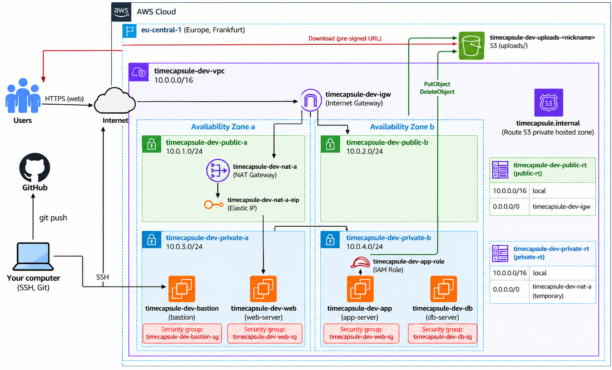

Схема архитектуры после выполнения lab4.

Ссылка на adr:
https://github.com/blackrosegarrote-cloud/timecapsule/blob/main/open_capsules_php_functional/docs/adr/0003-attachment-storage.md

## Контрольные вопросы

### 1. Как проходит запрос на скачивание вложения: от нажатия ссылки в браузере до получения файла? Где на этом пути проверяются права пользователя приложения, а где права роли?

При нажатии на вложение браузер отправляет запрос PHP-приложению. Приложение проверяет, имеет ли пользователь право просматривать капсулу и открыта ли она. Затем функция `storage_stream()` создаёт подписанный URL для объекта S3 сроком на 5 минут и перенаправляет браузер с HTTP-кодом 302. Браузер обращается напрямую к S3, который проверяет подпись, срок действия ссылки и соответствующие разрешения на получение объекта. После успешной проверки S3 отправляет файл браузеру. Права пользователя проверяются в PHP-приложении до формирования ссылки, а права IAM-роли `timecapsule-dev-app-role` используются при создании подписанного запроса и проверяются S3 при обращении по нему.

### 2. Какие настройки бакета и какие свойства подписанного URL не дают постороннему открыть вложение по прямому адресу объекта?

В бакете отключены ACL, включён `Block all public access` и настроена политика, запрещающая обращения по HTTP. Поэтому обычный Object URL не предоставляет доступа к файлу без авторизации. Подписанный URL содержит цифровую подпись, срок действия и параметры конкретного запроса. Изменение ключа объекта нарушает подпись, а после истечения пяти минут ссылка становится недействительной. Таким образом, получить файл можно только по корректной действующей ссылке или при наличии собственных AWS-разрешений.

### 3. Почему приложение отдаёт файлы через подписанный URL, а не открывает бакет для чтения всем?

Подписанные URL позволяют предоставлять временный доступ только к конкретному вложению после проверки прав пользователя в приложении. При этом бакет остаётся закрытым для публичного чтения. Если открыть бакет для всех, любой пользователь, знающий адрес объекта, сможет получить его без проверки доступа к капсуле. Кроме того, подписанные ссылки позволяют передавать файлы напрямую из S3, не расходуя ресурсы сервера приложения на их скачивание и отправку.

### 4. Как изменится схема, если вложения должны пережить отказ всего региона eu-central-1?

Необходимо создать дополнительный бакет S3 в другом регионе AWS, например `eu-west-1`, и настроить Cross-Region Replication (CRR) для автоматического копирования вложений между регионами. Для репликации требуется включить версионирование в обоих бакетах.

При отказе `eu-central-1` приложение должно переключиться на резервный регион и формировать подписанные URL для резервного бакета. Для полноценной отказоустойчивости также потребуются резервные серверы приложения, копия базы данных и переключение пользовательского трафика, например через Route 53. Поскольку репликация асинхронная, самые последние загруженные файлы могут не успеть скопироваться до сбоя.
