# Лабораторная работа №5. Облачные базы данных. Amazon RDS

**Выполнил**

- Балев Вадим

**Группа**
- I2402

**Специальность**
- Информатика

**Уровень**
- Продвинутый

**Ссылка на публичный репозиторий в организации GitHub**

- https://github.com/blackrosegarrote-cloud/timecapsule

## Цель работы

Научиться создавать и настраивать базу данных PostgreSQL в Amazon RDS, ограничивать сетевой доступ к ней, подключаться с EC2, создавать реплики для чтения и восстанавливать данные после случайного удаления с помощью резервных копий.

## Ход работы

### Задание 1. Размещение и доступ к базе

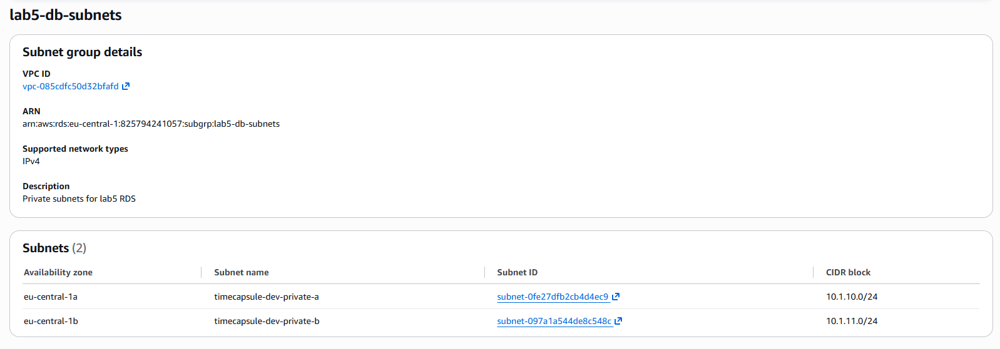

Создание группы подсетей `lab5-db-subnets`, включающей приватные подсети `private-a` и `private-b` из VPC, созданной в ЛР3.

Для веб-сервера была создана отдельная Security Group, которая используется как разрешённый источник подключений к базе.

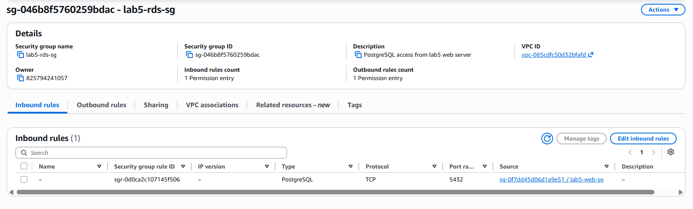

Создание `lab5-rds-sg`. Входящие подключения по TCP-порту `5432` разрешены только от Security Group веб-сервера. Остальные входящие подключения не разрешены.

**Вопросы**

- **Почему для ограничения доступа удобнее использовать Security Group источника, а не его IP-адрес?**
  - IP-адрес EC2 может измениться при пересоздании экземпляра. Security Group позволяет предоставлять доступ всем экземплярам с назначенной группой независимо от их IP-адресов, избавляя от необходимости обновлять правила вручную.

- **Зачем указывать две подсети, если учебная база будет работать в одной зоне?**
  - Amazon RDS обычно требует подсети минимум в двух зонах доступности. Это позволяет в дальнейшем использовать Multi-AZ или размещать экземпляры в другой зоне. Основная база при этом находится только в `eu-central-1a`.

### Задание 2. База RDS

Создание экземпляра RDS `lab5-db` с PostgreSQL, шаблоном `Sandbox`, классом `db.t4g.micro` и хранилищем `gp3` на 20 ГиБ без автоматического увеличения.

Для подключения выбран пользователь `dbadmin`, внутри экземпляра создана база `lab5`. Указаны группа подсетей `lab5-db-subnets`, зона `eu-central-1a` и Security Group `lab5-rds-sg`. Публичный доступ отключён.

Резервные копии хранятся 7 дней, включены шифрование и защита от удаления.

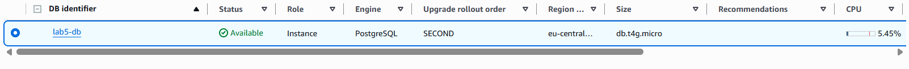

Экземпляр `lab5-db` перешёл в состояние `Available`. Основные параметры базы соответствуют требованиям задания.

**Вопросы**

- **Как убедиться, что база принимает подключения только с нужного сервера?**
  - Проверить, что `lab5-rds-sg` разрешает порт `5432` только от Security Group веб-сервера. Затем подключиться через `psql` с разрешённого EC2 и проверить отказ подключения с другого источника. Security Group ограничивает сетевой доступ, а PostgreSQL проверяет учётные данные.

- **Почему для базы выбрана зона `eu-central-1a`?**
  - Зона выбрана по условию задания. Размещение приложения и базы в одной зоне уменьшает задержку и исключает плату за межзонный трафик между ними, но не защищает от отказа самой зоны.

- **От чего защищает `deletion protection`, а от чего нет?**
  - Защищает экземпляр RDS от случайного удаления через AWS, пока настройка включена. Однако не предотвращает удаление или изменение данных командами `DELETE`, `DROP TABLE` и другими операциями. Для восстановления данных нужны резервные копии.

### Задание 3. Подключение к базе

Был создан экземпляр EC2 веб-сервера с назначенной Security Group из задания 1.

Подключение к RDS с веб-сервера:

```bash
psql -h <endpoint> -U dbadmin -d lab5
```

Проверка соединения:

```sql
SELECT version();
\conninfo
```

Создание таблицы и добавление записей:

```sql
CREATE TABLE notes (
    id         SERIAL PRIMARY KEY,
    body       VARCHAR(100) NOT NULL,
    created_at TIMESTAMPTZ NOT NULL DEFAULT now()
);

INSERT INTO notes (body)
VALUES ('first'), ('second'), ('third');

SELECT * FROM notes;
```

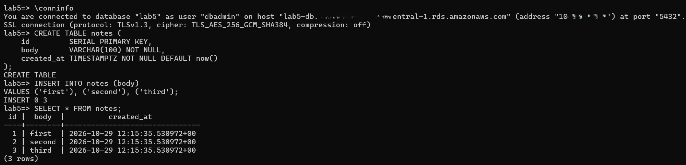

Успешное подключение к базе `lab5` под пользователем `dbadmin`. Команда `\conninfo` подтверждает соединение, а `SELECT * FROM notes` возвращает три добавленные записи.

**Проверка сетевого доступа**

Для определения IP-адреса RDS на веб-сервере и локальном компьютере выполнена команда:

```bash
nslookup <endpoint>
```

DNS-имя RDS разрешается в приватный IP-адрес, однако само по себе разрешение имени не означает доступность базы по сети.

Для проверки TCP-подключения использована команда:

```bash
nc -vz <endpoint> 5432
```

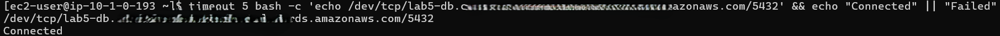

Проверка доступа к порту `5432` с разрешённого EC2 и с другого источника. Соединение с разрешённого сервера устанавливается.

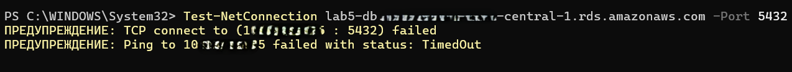

Подключение с источника без необходимого сетевого доступа завершается неудачей.

### Задание 4. Реплика для чтения

Для основной базы `lab5-db` создана реплика `lab5-db-replica` в зоне `eu-central-1b`. Выбран класс `db.t4g.micro`, публичный доступ отключён, применены те же правила сетевого доступа, что и у основной базы. Защита от удаления не включена.

После перехода реплики в состояние `Available` выполнено подключение:

```bash
psql -h <replica-endpoint> -U dbadmin -d lab5
```

Проверка режима работы и содержимого:

```sql
SELECT pg_is_in_recovery();
SELECT * FROM notes;
```

Функция `pg_is_in_recovery()` на реплике возвращает `true`, а таблица `notes` содержит записи основной базы.

Попытка добавления записи:

```sql
INSERT INTO notes (body) VALUES ('from replica');
```

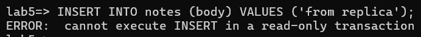

Команда `INSERT` завершилась ошибкой, поскольку реплика доступна только для чтения.

На основной базе выполнена проверка:

```sql
SELECT pg_is_in_recovery();
```

Результат `false` подтверждает, что основная база не находится в режиме восстановления и может принимать операции записи.

Добавление новой записи на основной базе:

```sql
INSERT INTO notes (body) VALUES ('fourth');
```

Проверка на реплике:

```sql
SELECT * FROM notes;
```

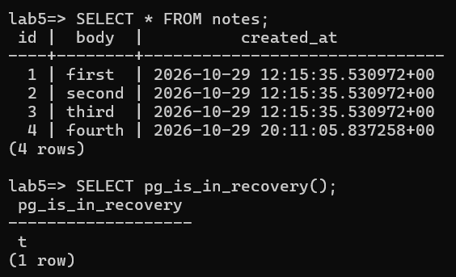

На реплике появилась строка `fourth`, добавленная на основной базе. Это подтверждает передачу изменений от основной базы к реплике.

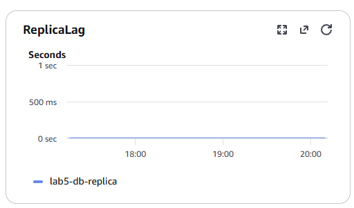

Просмотр метрики `ReplicaLag` во вкладке `Monitoring`. Она показывает отставание реплики от основной базы в секундах.

**Вопросы**

- **Почему `INSERT` на реплике не выполнился?**
  - Read Replica работает в режиме `read-only` и получает изменения от основной базы. Поэтому запросы `SELECT` разрешены, а операции `INSERT`, `UPDATE` и `DELETE` отклоняются.

- **Чем реплика для чтения отличается от резервного экземпляра Multi-AZ?**
  - Read Replica распределяет нагрузку чтения и получает изменения асинхронно, поэтому возможна задержка. Multi-AZ предназначен для отказоустойчивости: резервный экземпляр синхронно получает изменения и автоматически принимает работу при отказе основной базы. В классической Multi-AZ конфигурации резервный экземпляр не обслуживает запросы чтения.

### Задание 5. Восстановление после ошибки

Определение времени на основной базе:

```sql
SELECT now() AT TIME ZONE 'UTC';
```

Полученное время было зафиксировано для последующего восстановления.

Через минуту выполнено удаление всех строк:

```sql
DELETE FROM notes;
```

Проверка состояния основной базы и реплики:

```sql
SELECT * FROM notes;
```

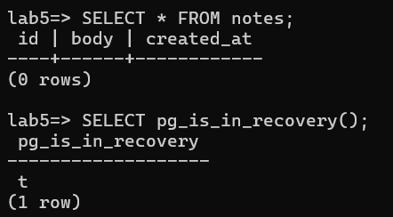

После выполнения `DELETE` таблица `notes` стала пустой. Удаление также передалось на реплику, поскольку она повторяет изменения основной базы.

Реплика `lab5-db-replica` была удалена, поскольку больше не требовалась для дальнейшего выполнения работы.

Во вкладке `Maintenance & backups` проверено значение `Latest restore time`, чтобы убедиться в возможности восстановления на момент до удаления данных.

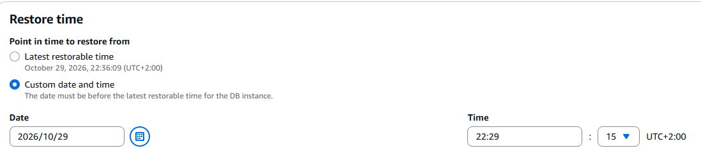

Заполнение формы `Restore to point in time`. Выбрано время до выполнения `DELETE` с учётом часового пояса, указанного в интерфейсе AWS.

Для восстановленного экземпляра указаны имя `lab5-db-restore`, класс `db.t4g.micro`, группа подсетей `lab5-db-subnets`, одна зона доступности, отсутствие публичного доступа и те же правила сетевого доступа, что у основной базы. Защита от удаления отключена.


Экземпляр `lab5-db-restore` перешёл в состояние `Available` и готов принимать подключения.

Подключение к восстановленной базе:

```bash
psql -h <restore-endpoint> -U dbadmin -d lab5
```

Проверка содержимого:

```sql
SELECT * FROM notes;
```

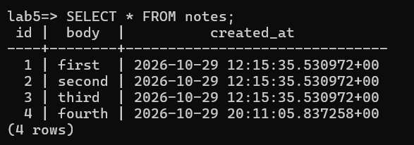

В восстановленной базе снова присутствуют четыре записи: `first`, `second`, `third` и `fourth`. Данные восстановлены на момент до выполнения ошибочной операции удаления.

После проверки экземпляр `lab5-db-restore` был удалён без финального снимка и сохранения автоматических резервных копий.

**Вопросы**

- **Почему реплика не спасла данные?**
  - Реплика автоматически повторяет изменения основной базы, включая ошибочный `DELETE`. Поэтому удалённые строки исчезли и на реплике. Репликация не заменяет резервное копирование и не защищает от подобных логических ошибок.

- **Почему восстановление создаёт новую базу, а не откатывает старую?**
  - Point-in-Time Recovery создаёт новый экземпляр, сохраняя исходную базу без изменений. Это позволяет проверить восстановленные данные перед переключением приложения и при необходимости продолжить использовать старую базу.

### Задание 6. База приложения

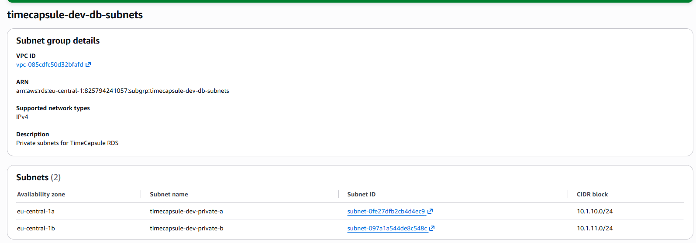

Создание группы подсетей `timecapsule-dev-db-subnets`, включающей приватные подсети `private-a` и `private-b` из двух зон доступности.

Создание Security Group `timecapsule-dev-rds-sg`, разрешающей подключения по TCP-порту `5432` только от Security Group сервера приложения.

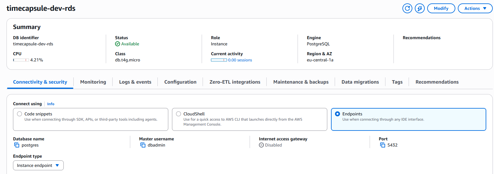

Создание экземпляра RDS `timecapsule-dev-rds` с PostgreSQL, классом `db.t4g.micro` и хранилищем `gp3` на 20 ГиБ. Выбраны приватная группа подсетей, отсутствие публичного доступа, резервное копирование на 7 дней, шифрование и защита от удаления.

Поле `Initial database name` оставлено пустым, поскольку база `timecapsule` будет создана отдельно.

**Вопрос**

- **Какие параметры базы приложения вы выбрали бы иначе для рабочей системы с реальными пользователями? Почему?**
  - Для рабочей системы стоило бы выбрать более производительный класс экземпляра, настроить Multi-AZ для автоматического переключения при отказе зоны и увеличить период хранения резервных копий. Также следовало бы включить расширенный мониторинг и отказаться от ежедневной остановки базы, поскольку она должна быть доступна пользователям постоянно. Это увеличит расходы, но повысит производительность и отказоустойчивость.

### Задание 7. Ночная остановка базы

Создание IAM-политики `timecapsule-dev-rds-stop`, разрешающей действие `rds:StopDBInstance` исключительно для экземпляра `timecapsule-dev-rds`.

Создание роли `timecapsule-dev-scheduler-role` с данной политикой. Доверие к роли предоставлено сервису `scheduler.amazonaws.com`.

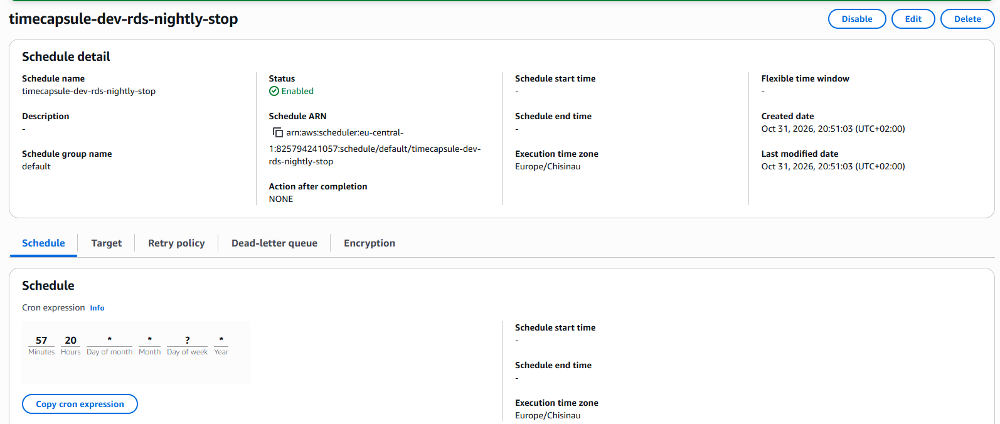

Создание расписания `timecapsule-dev-rds-nightly-stop` в EventBridge Scheduler. Для проверки задано время через несколько минут, часовой пояс `Europe/Chisinau`, `Flexible time window` отключён.

В качестве действия выбрано `Amazon RDS → StopDBInstance` с параметрами:

```json
{
  "DbInstanceIdentifier": "timecapsule-dev-rds"
}
```

Для выполнения действия используется роль `timecapsule-dev-scheduler-role`.

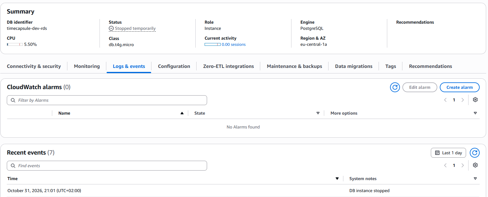

Проверка выполнения расписания. Экземпляр RDS перешёл в состояние `Stopped`, что подтверждает успешную работу Scheduler.

После проверки выражение расписания изменено на:

```text
0 23 * * ? *
```

Теперь база автоматически останавливается каждый день в 23:00 по времени Кишинёва. Для продолжения лабораторной база была запущена вручную.

**Вопросы**

- **Зачем расписанию своя роль, если вы и сами можете остановить базу?**
  - EventBridge Scheduler выполняет действия самостоятельно, а не от имени пользователя, создавшего расписание. Поэтому ему нужна IAM-роль, которую сервис может принять и использовать для вызова API AWS. Это позволяет выполнять действия автоматически без пользовательских учётных данных.

- **Почему роль может остановить только одну базу?**
  - IAM-политика разрешает `rds:StopDBInstance` только для ARN экземпляра `timecapsule-dev-rds`. Такой подход соответствует принципу минимальных привилегий: даже при неправильной настройке расписание не сможет остановить другие базы аккаунта.

### Задание 8. Пользователь и база данных

Подключение к RDS с сервера приложения под пользователем `dbadmin`:

```bash
psql -h <endpoint> -U dbadmin -d postgres
```

Создание отдельного пользователя и базы данных для приложения:

```sql
CREATE USER timecapsule;
\password timecapsule
GRANT timecapsule TO dbadmin;
CREATE DATABASE timecapsule OWNER timecapsule;
```

В качестве пароля используется значение `DB_PASSWORD` из `.env`, чтобы не изменять настройки приложения.

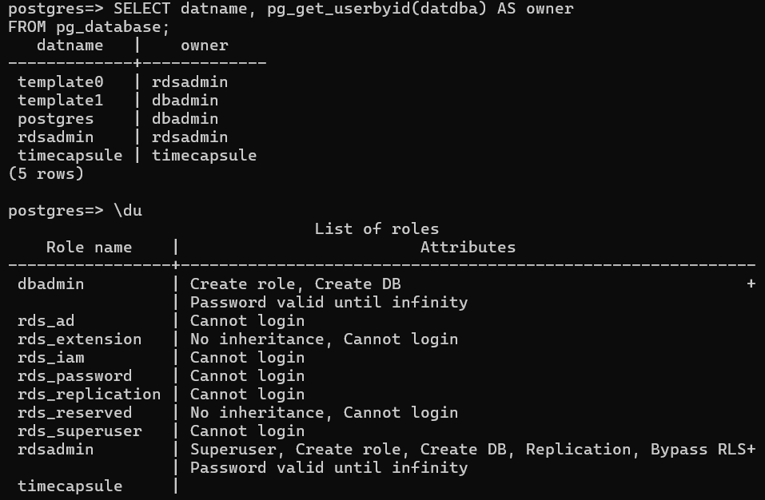

Созданы пользователь `timecapsule` и одноимённая база данных, владельцем которой является новый пользователь.

**Вопрос**

- **Почему приложению нужен отдельный пользователь, а не `dbadmin`?**
  - `dbadmin` обладает административными привилегиями и предназначен для управления базой. Приложению достаточно прав на собственную базу данных. Использование отдельного пользователя ограничивает возможный ущерб при компрометации приложения и соответствует принципу минимальных привилегий.

### Задание 9. Перенос данных

Перед переносом данных прекращено использование приложения, чтобы избежать появления новых записей в старой базе после создания выгрузки.

На `app-server` выполнена команда:

```bash
pg_dump -h db.timecapsule.internal -U timecapsule -d timecapsule --no-owner --no-privileges -f timecapsule.sql
```

Создан файл `timecapsule.sql`, содержащий структуру и данные старой базы. Параметры `--no-owner` и `--no-privileges` исключают восстановление прежних владельцев и прав доступа.

Загрузка данных в RDS:

```bash
psql -h <endpoint> -U timecapsule -d timecapsule -f timecapsule.sql
```

После переноса выполнена проверка количества записей в обеих базах:

```sql
SELECT COUNT(*) FROM users;
SELECT COUNT(*) FROM capsules;
```

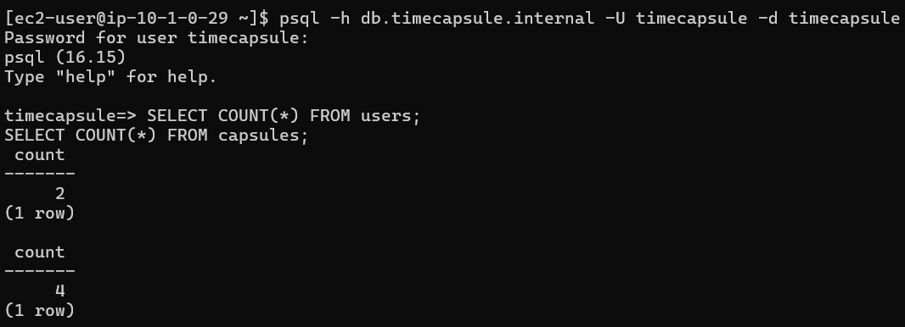

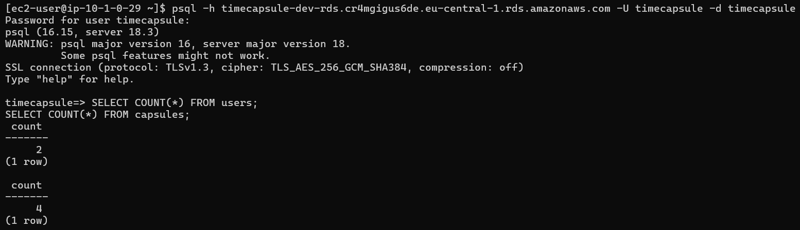

Сравнение количества записей в таблицах `users` и `capsules` старой базы и RDS. Результаты совпадают, что подтверждает перенос данных.

После проверки файл выгрузки удалён:

```bash
rm timecapsule.sql
```

Удаление необходимо, поскольку файл содержит данные пользователей, включая хеши паролей.

### Задание 10. Переключение приложения

В приватной зоне Route 53 `timecapsule.internal` удалена A-запись `db`, которая указывала на старый `db-server`.

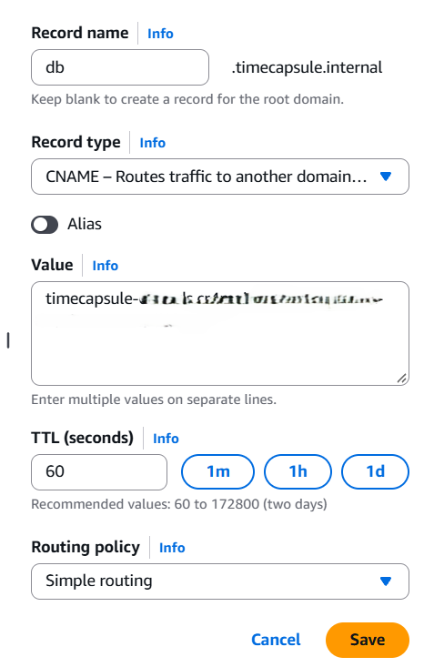

Создание CNAME-записи `db.timecapsule.internal`, указывающей на endpoint нового экземпляра RDS. Благодаря этому приложению не требуется менять значение `DB_HOST`.

Для соединения с PostgreSQL используется TLS. Дополнительные параметры PHP-приложению не потребовались, поскольку драйвер PostgreSQL поддерживает автоматическое согласование шифрования.

После изменения DNS выполнена проверка приложения через `/health`, а также создание новой капсулы.

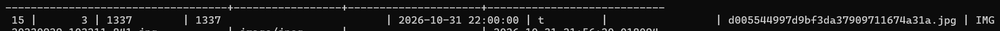

Проверка работоспособности TimeCapsule после переключения на RDS. Приложение успешно подключается к новой базе, а созданная капсула отображается в таблице `capsules`.

Старый экземпляр `db-server` был остановлен. После повторной проверки работоспособности приложения сервер удалён.

**Вопросы**

- **Почему не пришлось менять `DB_HOST`?**
  - Приложение по-прежнему обращается к `db.timecapsule.internal`, но теперь это имя через CNAME разрешается в endpoint RDS вместо IP-адреса старого сервера. Таким образом, источник подключения изменился без изменения конфигурации приложения.

- **Какие обязанности из ЛР3 перешли к AWS, а какие остались за вами?**
  - AWS теперь отвечает за инфраструктуру базы, обслуживание ОС и PostgreSQL, автоматические резервные копии и восстановление экземпляра. За пользователем остаются управление доступом, настройка схемы и пользователей базы, миграции данных, мониторинг приложения и принятие решений о восстановлении. Также необходимо самостоятельно выбирать подходящие параметры производительности и отказоустойчивости.

### Задание 11. Обслуживание базы

Для проверки поведения приложения при недоступности базы выполнена перезагрузка `timecapsule-dev-rds`.

Во время перезагрузки проводилась проверка эндпоинта `/health`.

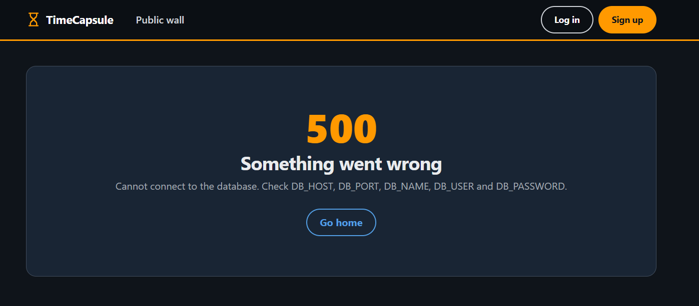

Проверка `/health` во время перезагрузки RDS. При временной недоступности PostgreSQL приложение не может выполнить проверочный запрос к базе и возвращает ошибку.

Во вкладке `Logs & events` просмотрены события экземпляра, связанные с перезагрузкой, остановкой и запуском базы.

Затем база была остановлена вручную, после чего повторно проверена работа приложения.

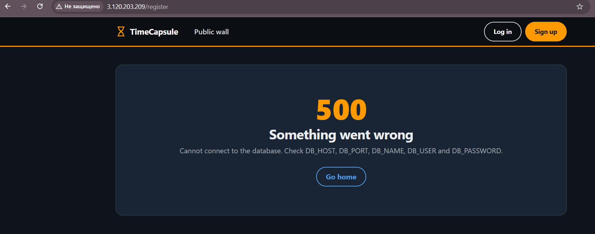

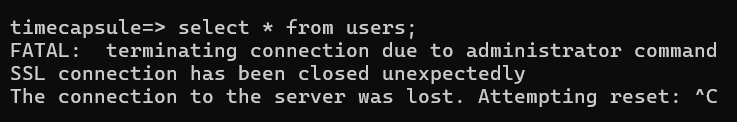

Проверка состояния RDS и приложения при остановленной базе. Подключение к PostgreSQL недоступно, поэтому операции приложения, требующие обращения к базе, завершаются ошибкой.

После запуска RDS и перехода в состояние `Available` работоспособность приложения была восстановлена.

**Вопросы**

- **Что показывал `/health` во время перезагрузки?**
  - Во время недоступности PostgreSQL эндпоинт `/health` возвращал ошибку, поскольку не мог выполнить проверочный запрос к базе. После завершения перезагрузки соединение восстановилось, и проверка снова стала успешной.

- **Изменился ли endpoint после остановки и запуска?**
  - Нет, DNS-имя endpoint RDS остаётся прежним. При этом внутренний IP-адрес экземпляра может измениться, поэтому приложение должно использовать DNS-имя, а не фиксированный IP-адрес.

- **Какую ошибку получает расписание, если база уже остановлена?**
  - При повторном вызове `StopDBInstance` для остановленного экземпляра RDS возвращает ошибку `InvalidDBInstanceState`, поскольку база уже находится в состоянии `Stopped` и не может быть остановлена повторно. Повторное действие не меняет её состояние.

### Задание 12. Архитектура и решение

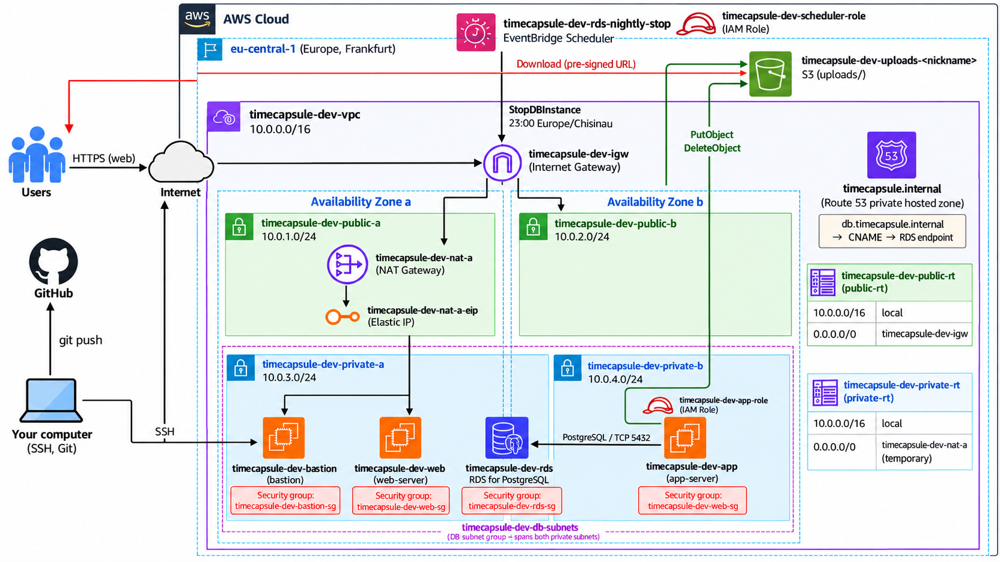

Схема архитектуры после выполнения Lab5.

Ссылка на adr:

https://github.com/blackrosegarrote-cloud/timecapsule/blob/main/open_capsules_php_functional/docs/adr/0004-database-hosting.md

## Контрольные вопросы

1. Как проходит запрос от браузера до базы? Какие проверки проходит соединение на каждом шаге?

Браузер отправляет HTTPS-запрос к приложению. Запрос проходит через Internet Gateway и Security Group сервера, после чего nginx передаёт его PHP-FPM. PHP-код обращается к `db.timecapsule.internal`, который через CNAME указывает на endpoint RDS. Security Group базы разрешает TCP-подключение на порт `5432` только от серверов приложения. PostgreSQL проверяет учётные данные пользователя `timecapsule` и его права на запрашиваемые данные. После выполнения SQL-запроса результат возвращается приложению, а затем браузеру.

2. Чем репликация отличается от резервного копирования?

Репликация передаёт изменения основной базы на другую, позволяя распределять нагрузку или повышать отказоустойчивость. Однако ошибочные операции, например `DELETE`, также передаются на реплику. Резервное копирование сохраняет возможность восстановления прежнего состояния данных. В RDS автоматические копии и журналы транзакций позволяют восстановить базу на выбранный момент в пределах установленного периода хранения.

3. Как пережить отказ зоны `eu-central-1a` и сколько это будет стоить?

Для защиты от отказа зоны можно использовать RDS Multi-AZ, разместив резервный экземпляр в `eu-central-1b`. При отказе основной зоны AWS автоматически переключится на резервную базу, обычно за 1–2 минуты. Endpoint останется прежним, но соединения потребуется восстановить. Такая конфигурация стоит примерно вдвое дороже Single-AZ из-за дополнительного экземпляра и хранилища.

4. Как вы решили проблему автоматического запуска базы через 7 дней?

Было создано расписание EventBridge Scheduler `timecapsule-dev-rds-nightly-stop`, которое ежедневно в 23:00 вызывает `StopDBInstance` для `timecapsule-dev-rds`. Если AWS автоматически запустит базу после 7 дней остановки, ближайшее вечернее расписание снова её остановит. Таким образом, база не останется работающей постоянно, хотя между автоматическим запуском и следующей остановкой возможны расходы.
